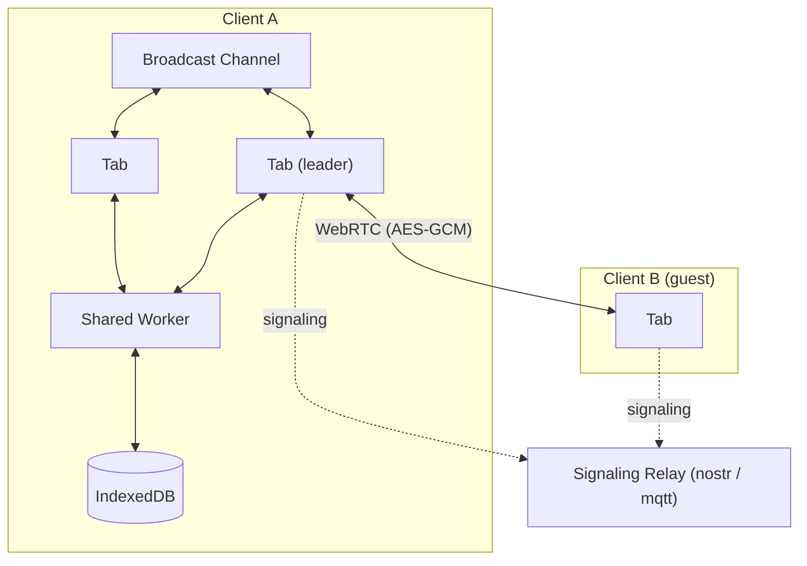

# ERD Editor

> ER 図エディター

[English](./README.md) | [한국어](./README.ko.md) | [中文](./README.zh-CN.md) | 日本語


データベーススキーマを視覚的に設計し、既存のスキーマは SQL DDL、GraphQL SDL、DBML、AML から取り込み、DDL や生成コードとして書き出せます。ERD Editor は erd-editor.io、Google Drive、VS Code、IntelliJ 系 IDE、Obsidian、そして自分のページに組み込むカスタム要素まで、ひとつのエディターとひとつのファイル形式で動き、コーディングエージェントは MCP サーバーを通じて同じ図を編集します。

## 使える場所

| | インストール | |
| --- | --- | --- |
| **Web アプリ** | [erd-editor.io](https://erd-editor.io) | インストール可能な PWA。オフラインでも起動し、リアルタイム共同編集に対応 |
| **Google Drive** | [Google Workspace Marketplace](https://workspace.google.com/marketplace/app/erd_editor/428467403360) | Drive の「アプリで開く」と「新規」メニューに ERD Editor を追加し、同じファイルに保存し直します |
| **VS Code** | [Marketplace](https://marketplace.visualstudio.com/items?itemName=dineug.vuerd-vscode) | `.erd.json` ファイルをカスタムエディターで開きます |
| **IntelliJ** | [JetBrains Marketplace](https://plugins.jetbrains.com/plugin/23594-erd-editor) | IntelliJ 系 IDE で同様に開きます |
| **Obsidian** | [コミュニティプラグイン](https://community.obsidian.md/plugins/erd-editor) | `.erd` と `.erd.json` ファイルを保管庫のタブで開きます。デスクトップ専用 |
| **自分のアプリ** | `npm install @dineug/erd-editor` | フレームワークに依存しない `<erd-editor>` カスタム要素 |
| **コーディングエージェント** | [`@dineug/erd-editor-mcp`](#コーディングエージェント) | Claude Code、Codex などの MCP クライアント向けサーバー。VS Code、JetBrains IDE、Obsidian ではリアルタイムに、それ以外ではファイルを直接編集します |

IDE で試すには、拡張子 `.erd.json` の空ファイルを作って開きます。Obsidian では、Obsidian のコマンドパレットから **ERD Editor: Create new diagram** を実行します。Google Drive では **新規 → その他 → ERD Editor** を選びます。

## 機能

### 設計

- **視覚的なスキーマ設計** — テーブル、列、メモ、そして 4 種類の関係カーディナリティ（Zero One、Zero N、One Only、One N）
- **素早い編集** — `Alt`+`N` でテーブル、`Alt`+`Enter` で列を追加し、`Alt`+`K` はフォーカス中の列の主キーを切り替え（その列が選択に含まれていれば選択中のすべての列に）、`Delete` または `Backspace` は選択項目を削除します。どれも元に戻す操作 1 回で戻せます。フローティングツールバーからはテーブル、メモ、テーブルグループを追加でき、エディターの設定タブにあるショートカットページにすべてのキーがあります
- **既存の列をつなぐ** — マウスやペンで関係を引くとき、終点のテーブル横に出るボタンで、親のキーをそのテーブルにある列に対応付けるか、新しい列を追加します。新しい列はキーが 1 語なら親テーブル名を付けて命名され（`user` の `id` なら `user_id`）、関係の右クリックメニューの **列のマッピング** で後から変更できます
- **参照動作** — 関係の右クリックメニューから **ON DELETE** と **ON UPDATE**（NO ACTION、CASCADE、SET NULL、SET DEFAULT、RESTRICT）を設定します。現在のデータベースにない値には印が付き、線の子側の端に `D:C U:R` のように表示され、表示オプションの参照動作でラベルを隠せます。SQL、DBML、AML のインポートはこれを読み取り、DDL エクスポートと、これを表せるコード生成は、対象が対応する値を書き出します
- **代替キー** — 表示オプションの代替キーを有効にすると、2 列以上にまたがる一意インデックスの各列に `AK1.1`、`AK1.2` のような印が付き、SQL インポートは複数列の UNIQUE をそのようなインデックス 1 つとして読み取ります
- **テーブルグループ** — キャンバスメニュー、コマンドパレット、フローティングツールバーの **新しいテーブルグループ** か `Alt`+`G` で、関連するテーブルの背後に名前と色を付けられる枠を描くか、選択したテーブルの右クリックメニューか `T` に続く `G` でグループ化します。テーブルは枠の中に置くとグループに入り、外に出すと抜けます。タイトルをドラッグするとグループ内のテーブルも一緒に動き、各メンバーのヘッダーはグループの色になり、表示オプションでグループを隠せ、DBML インポートとコード生成の DBML はグループを `TableGroup` として扱います
- **自動レイアウト** — キャンバスメニューかコマンドパレットから、力学モデル、フロー、縦または横のツリーですべてのテーブルを再配置します。テーブルグループはまとまったまま動き、元に戻す操作 1 回で戻せます。力学モデルは適用かキャンセルを選べるプレビューを表示し、それ以外は即座に配置されます
- **コピー、貼り付け、色** — テーブルとメモをコピーして新しい項目として貼り付けます。別の図にも貼り付けられ、スプレッドシートには表として貼り付けられます。`Alt` を押しながらドラッグすると複製でき、テーブル、メモ、テーブルグループの色は右クリックメニューで設定します
- **きれいな差分** — スクロール位置とズーム、開いているタブ、コード生成の言語と名前のケース、囲み文字の種類は既定でロックされており、ファイルはロック時の値を保持するため、眺めて回るだけでファイルは変わりません。ファイルは固定された順序で書かれ、計測した幅、コネクターのアンカー、削除済みの項目は含みません

### インポート

- **SQL DDL インポート** — 下記 8 種類のデータベースの `.sql` ダンプを取り込みます。パーサーは `CREATE TABLE`、`CREATE INDEX`、`ALTER TABLE` の制約、テーブルと列のコメント（`COMMENT ON`、SQL Server の `sp_addextendedproperty`）を読み取り、認識できないものは飛ばすので、癖のあるダンプでも丸ごと失敗せずに読める部分が取り込まれます
- **GraphQL SDL インポート** — SDL を出力するどのツールのスキーマでも取り込みます。オブジェクト型はテーブルに、スカラーは図のデータ型に対応付けられ、別の型を指すフィールドは関係になります。ルート型と、Relay、Federation、Hasura が生成するラッパー型はテーブルとして描かず除外します
- **DBML インポート** — dbdiagram.io や dbdocs.io 向けに書いた `.dbml` ファイル、または `sql2dbml` や `prisma-dbml-generator` が出力したファイルを取り込みます。テーブル、列、インデックス、enum、ヘッダーの色、あらゆる `Ref` の書き方、各 `TableGroup` が入り、`Project` や付箋の `Note` は拒否せず飛ばします
- **AML インポート** — [Azimutt](https://azimutt.app) 向けの `.aml` ファイルを、v2 と旧 v1 のどちらの書き方でも取り込みます。エンティティ、属性、インデックス、enum、色、あらゆる関係の矢印が入り、check と struct 型は拒否せず飛ばし、view はテーブルとして入ります
- **インポートは配置済みで届く** — インポートメニュー、コマンドパレット、ホストのファイルダイアログから選んだスキーマは、テーブルが関係に従って配置された状態（関係がなければ行に並べて）で届き、元に戻す操作 1 回で前の図に戻ります。erd-editor.io のスキーマ一覧や Google Drive エディターに取り込んだ SQL、DBML、AML、GraphQL ファイルは、同じように配置された新しい図になります
- **インポートして追加** — インポートの隣のメニューと、コマンドパレットの 5 形式から、`.sql`、GraphQL、DBML、AML、`.erd.json` ファイルを図を置き換えるのではなく追加します。テーブルは既存のものの下に同じ方法で配置され（`.erd.json` ファイルは自身の配置を保持）、選択された状態で届き、元に戻す操作 1 回で消えます。既に同名のテーブルがある場合はマージせず 2 つ目のテーブルとして入り、ファイル外のテーブルを指す外部キーは捨てられます

### エクスポートとコード

- **SQL DDL エクスポート** — Databricks、MariaDB、MSSQL、MySQL、Oracle、PostgreSQL、Snowflake、SQLite。スキーマ SQL タブで DDL を `.sql` ファイルとして保存するかコピーします
- **スキーマ SQL のオプション** — DDL 横のパネルで、データベースと囲み文字の種類、CREATE TABLE IF NOT EXISTS か削除して再作成か、`USE` または `CREATE + USE` のヘッダー（データベースが対応する場合のみ）、テーブルグループごとのテーブルを選び、テーブルの前後に書く独自の SQL を保持します。ステートメント、ヘッダー、テーブルの選択はこのエディターを閉じるまでのもので、ファイルには届きません。スクリプトはドキュメントに保存されます
- **コード生成** — TypeScript、GraphQL、C#、Java、JPA、Kotlin、Scala、Go、SQLAlchemy、TypeORM、Sequelize、Drizzle、DBML、AML、Mermaid、PHP、Doctrine、Rust、SeaORM、Swift、Zod、JSON Schema をコード生成タブで生成します。オプションパネルで言語、データベース、テーブル名と列名のケース、Doctrine、JPA、SeaORM では囲み文字の種類を選び、コードをその言語の拡張子を持つファイルとして保存します
- **エクスポート** — `.erd.json`、`.sql`、そしてプレビュー付きダイアログから `.png` または `.svg`。透明背景、ライトまたはダーク、PNG は 1x〜3x の倍率か、代わりにクリップボードへコピー

### 検索と移動

- **クイック検索** — `Ctrl`/`Cmd`+`K` でコマンドパレットを開き、エディターのコマンド（新しいテーブル、インポート、エクスポート、自動レイアウト、タブ、テーマ、言語など）を実行するか、`#` に続けてテーブル、`@` に続けて列、`:` に続けてコメントやメモを入力してジャンプします。韓国語は初声でも一致します（`ㅅㅇㅈ` で 사용자 が見つかる）
- **エクスプローラー** — ツールバーのエクスプローラーボタンで、テーブルとその列・インデックス・外部キー、テーブルグループ、メモのツリーをキャンバスの横に開き、行をクリックするとその対象へ移動します。`Ctrl`/`Cmd`+`F` でテーブル名、列名、インデックス名、グループ名、コメント、メモを、大文字小文字の区別、単語単位、正規表現、大文字小文字の保持で検索し、すべて置換は元に戻す操作 1 回で戻せます
- **可視化** — グラフモードはテーブル同士の関係を力学モデルで描きます。フローモードはテーブルを関係に従って配置し、ホバーしたテーブルとそれに関係するテーブルを強調し、名前のみ、キーのみ、全フィールドのいずれかで表示します。テーブルの右クリックメニューの **このテーブルにフォーカス** はそのテーブルと隣接テーブルだけでフローを開き、複数のテーブルを選択しているときは **選択したテーブルにフォーカス** として選択中のすべてとその隣接を表示します。`Alt`+`F` も選択に対して同じことをします。どちらのビューも配置をファイルに書きません
- **ズームとパン** — トラックパッドのピンチや 2 本指でズームし、中ボタンのドラッグでどこからでもパンし、フローティングツールバーのズーム率をクリックすると 100% に戻ります
- **タイムトラベル** — ツールバーから、この編集セッションの履歴をキャンバス上で再生し、任意の時点にジャンプします
- **差分ビューアー** — キャンバスメニューから、図を別の `.json` ファイルと比較します。ツリーが追加・変更・削除・名前変更されたものを一覧にし、両方のペインがキャンバス上で示します
- **元に戻す / やり直す** — すべての編集を、ツールバーまたは `Ctrl`/`Cmd`+`Z` と `Ctrl`/`Cmd`+`Shift`+`Z` で、エディター自身の履歴から戻します

### 言語とテーマ

- **表示言語** — エディターのメニュー、パネル、ダイアログ、コマンドパレット、メッセージを 25 言語で表示し、アラビア語、ヘブライ語、ペルシア語は右から左に配置しつつ、図は左から右のままです。ツールバーの言語ボタンかコマンドパレットの **表示言語** から選ぶか、既定のシステムのままにするとブラウザーやホストの言語に従い、エディターにない言語では英語を表示します。テーブル名と列名、SQL キーワード、データ型、生成コードはそのままです
- **テーマ** — ツールバーのテーマビルダーで外観（システム、ライト、ダーク）、グレー系の色、アクセントカラーを選び、コマンドパレットの **テーマ** は外観を選びます。システムは OS やホストのライト／ダークテーマに従い、選んだ値は erd-editor.io ではブラウザーに、各プラグインではその設定に保存され、npm 要素ではホストに委ねます
- **ウェルカム画面** — 編集可能な空の図は、新しいテーブル、新しいメモ、インポート、コマンドパレット、ショートカットのメニューで開き、キャンバスに余裕があればツールバーの検索、テーマ、言語ボタンとフローティングツールバーを矢印で示し、最初のテーブル、表示中のメモ、表示中のテーブルグループができるまで残ります。npm 要素はホストが有効にしたときだけウェルカム画面、言語ピッカー、テーマビルダーを表示し、ホストが言語を設定するかピッカーを有効にするまでは英語で表示します

### 共同編集とコーディングエージェント

- **リアルタイム共同編集**（実験的機能） — erd-editor.io のサイドバーからセッションを開始してリンクを共有すると、リンクを開いた全員が一緒に図を編集します。ピアツーピアでエンドツーエンド暗号化され、スキーマを保持するバックエンドはありません。要素を組み込む側は `getSharedStore()` で同じアクションストリームを受け取れます
- **コーディングエージェント** — Claude Code、Codex などあらゆる MCP クライアントが [`@dineug/erd-editor-mcp`](./packages/mcp-server) を通じて図を編集します。VS Code、Obsidian、JetBrains IDE ではキャンバス上にリアルタイムに反映され、エージェントの元に戻す操作は自身の編集だけを戻します。図を開いているエディターがなければ、ファイルそのものを編集します

## 組み込み

```sh
npm install @dineug/erd-editor
```

```js
import '@dineug/erd-editor';

const editor = document.createElement('erd-editor');
// エディターはコンテナーいっぱいに広がり、カスタム要素は既定で inline です
Object.assign(editor.style, { display: 'block', width: '100%', height: '100vh' });
document.body.appendChild(editor);
```

カスタム要素なので、どのフレームワークからでも、フレームワークなしでも使えます。インストール、属性、要素の API は [`packages/erd-editor`](./packages/erd-editor) を参照してください。

## リアルタイム共同編集（実験的機能）

[erd-editor.io](https://erd-editor.io) でスキーマを開き、サイドバーの共同編集ボタンから **Start session** を選んでリンクを共有します。リンクを開いた全員があなたと一緒に図を編集し、その編集はあなたのブラウザーに保存されます。リンクが唯一の鍵なので、編集を任せてよい相手にだけ共有してください。参加者はニックネームを設定でき、参加者一覧とポインターの横に表示されます。

セッションはホストのブラウザーにあります。ゲストは図のコピーを持たず、ホストが最後のタブを閉じるとセッションは終わるので、図が必要なゲストは先にエクスポートしておきます。

セッションは WebRTC によるピアツーピアで、図とすべての編集は AES-GCM で暗号化されます。シグナリングリレーはピア同士を引き合わせるだけで平文を見ることはありません。ルームの秘密鍵は URL フラグメントにあり、ブラウザーはフラグメントをどのリクエストにも含めないため、リレーも erd-editor.io のサーバーも鍵を受け取りません。ホストのブラウザーでは、開いているタブがリーダーを選出してすべてのピア接続を担い、ゲストのタブはそれぞれ個別に参加します。

<details>
<summary>アーキテクチャ</summary>



</details>

## コーディングエージェント

[`@dineug/erd-editor-mcp`](./packages/mcp-server) は、Claude Code、Codex などあらゆる MCP クライアントに編集操作ごとのツールを提供する MCP サーバーです。テーブルの追加、列の名前変更、2 つのテーブルの関連付け、DDL ダンプのインポート、スキーマの SQL としての読み出しなどです。VS Code のウィンドウ、Obsidian の保管庫、JetBrains IDE がその図を開いているか、ワークスペース、保管庫、プロジェクトの中に持っていれば、エージェントはそのエディターにもう一人の共同編集者として参加します。変更は起きたそばからキャンバスに現れ、エージェントの元に戻す操作は自身の編集だけを戻します。図を開いているエディターがなければ、同じツールがディスク上のファイルを編集します。接続をオフにしたエディターや、信頼していない VS Code のワークスペース・JetBrains のプロジェクトでは、エージェントは読み取れますが編集は拒否されます。編集してもエディターの次の保存で上書きされてしまうからです。サーバーには Node.js 22.12 以降が必要です。Claude Code なら、プロジェクトフォルダーで次を実行します:

```sh
claude mcp add --transport stdio erd-editor -- npx -y @dineug/erd-editor-mcp
```

[README](./packages/mcp-server) に Codex やその他のクライアントの設定と現在のツール一覧があり、[MCP ドキュメント](https://docs.erd-editor.io/docs/mcp/introduction) はサーバーのインストールと、ライブ編集・ヘッドレス編集を扱っています。


## ドキュメント

- [編集ガイド](https://docs.erd-editor.io/docs/category/guides) — 編集、インポートとエクスポート、関係、クイック検索、可視化、コード生成、設定
- [要素 API](https://docs.erd-editor.io/docs/api/erd-editor-element) — `<erd-editor>` 要素の API
- [MCP](https://docs.erd-editor.io/docs/mcp/introduction) — MCP サーバーのインストール、ライブ編集とヘッドレス編集、ツール
- [ドキュメント](https://docs.erd-editor.io)

## パッケージ

pnpm ワークスペースです。npm に公開しているパッケージは 2 つ、構文ハイライトまで含むエディター本体の [`@dineug/erd-editor`](./packages/erd-editor) と、コーディングエージェント向け MCP サーバーの [`@dineug/erd-editor-mcp`](./packages/mcp-server) です。3 つのプラグインはそれぞれのストアで配布され、`app` は erd-editor.io で、残りはそれらのビルドが取り込む非公開のライブラリーとバンドルです。

<details>
<summary>全 18 パッケージ</summary>

| フォルダー | npm 名 | 説明 |
| --- | --- | --- |
| [`erd-editor`](./packages/erd-editor) | `@dineug/erd-editor` | エディターのコア: `<erd-editor>` カスタム要素と、ヘッドレスの `engine.js`、`peer.js` エントリー |
| [`erd-editor-schema`](./packages/erd-editor-schema) | `@dineug/erd-editor-schema` | v2/v3 ドキュメントスキーマ、パース、シリアライザー、クエリ、LWW 演算子 |
| [`schema-sql-parser`](./packages/schema-sql-parser) | `@dineug/schema-sql-parser` | SQL インポートに使う寛容な DDL パーサー |
| [`uuid`](./packages/uuid) | `@dineug/uuid` | UUIDv7 と Uuid25 エンコーディング。エディターが発行する id |
| [`r-html`](./packages/r-html) | `@dineug/r-html` | エディターの基盤となるタグ付きテンプレートのレンダリングフレームワークとストア |
| [`vite-plugin-r-html`](./packages/vite-plugin-r-html) | `@dineug/vite-plugin-r-html` | JSX → タグ付きテンプレート、および HMR 境界 |
| [`app`](./packages/app) | `@dineug/erd-editor-app` | erd-editor.io の React PWA。`/gdrive` の Google Drive エディターを含み、その OAuth リレーは `functions/` の Pages Function |
| [`vscode-extension`](./packages/vscode-extension) | `vuerd-vscode` | 公開中の VS Code 拡張機能と、コーディングエージェントハブの拡張機能側 |
| [`vscode-webview`](./packages/vscode-webview) | `@dineug/erd-editor-vscode-webview` | VS Code の Webview 内のバンドル |
| [`webview-client`](./packages/webview-client) | `@dineug/erd-editor-webview-client` | IDE の Webview に組み込んだエディター。ホストプロトコル配線済みで、両 IDE バンドルが共有 |
| [`webview-bridge`](./packages/webview-bridge) | `@dineug/erd-editor-webview-bridge` | 型付きのホスト ↔ Webview コマンドプロトコル |
| [`replication-store-worker`](./packages/replication-store-worker) | `@dineug/erd-editor-replication-store-worker` | Worker 内のヘッドレスなドキュメントレプリカ。IDE の Webview と Obsidian プラグインが保存する内容をシリアライズ |
| [`intellij-webview`](./packages/intellij-webview) | `@dineug/erd-editor-intellij-webview` | IntelliJ プラグインのエディターパネル内のバンドル |
| [`intellij-plugin`](./packages/intellij-plugin) | `@dineug/erd-editor-intellij-plugin` | 公開中の IntelliJ プラグイン。Kotlin と Gradle 製で、コーディングエージェント用の Kotlin ハブを持つ |
| [`obsidian-plugin`](./packages/obsidian-plugin) | `@dineug/erd-editor-obsidian-plugin` | Obsidian プラグイン。[erd-editor-obsidian-plugin](https://github.com/dineug/erd-editor-obsidian-plugin) からリリース |
| [`agent-hub`](./packages/agent-hub) | `@dineug/erd-editor-agent-hub` | エディターのウィンドウとコーディングエージェントの MCP サーバーの間のプロトコル: メッセージ、ロックファイル、フレーミング |
| [`agent-hub-host`](./packages/agent-hub-host) | `@dineug/erd-editor-agent-hub-host` | そのプロトコルのエディターウィンドウ側。VS Code 拡張機能と Obsidian プラグインが共有し、IntelliJ プラグインは Kotlin に移植 |
| [`mcp-server`](./packages/mcp-server) | `@dineug/erd-editor-mcp` | 公開中の MCP サーバー。VS Code、Obsidian、JetBrains IDE ではライブに、それ以外ではファイルに対してヘッドレスで動作 |

</details>

## 開発

Node は 22 系なら 22.22.1 以降、24 系なら 24.11 以降、または 26 以降が必要で（`.nvmrc` は CI が使う `22.23.2` を固定）、pre-commit フックには Git 2.32 以降、そして `packageManager` が固定する pnpm `10.34.3` が必要です。IntelliJ プラグインは Gradle を動かす JDK 17 以降も必要で、プラグインがコンパイル対象とする JDK 21 は、なければ Gradle のツールチェーンリゾルバーが取得します。

`pnpm test` は `erd-editor` のブラウザースペックを Chromium で実行するので、最初に一度インストールします:

```sh
pnpm install
pnpm --filter @dineug/erd-editor exec playwright install --with-deps chromium
```

```sh
pnpm check                      # フォーマットと lint の検査、ルートの tsc、tools のスペック、タスク入力の検査
pnpm test                       # パッケージごとに: 依存関係のビルド、tsc --noEmit、ユニットとブラウザーのスペック
pnpm -r --no-bail test:coverage # 各パッケージのスペックをカバレッジ付きで。CI は pnpm test の後に実行
pnpm build                      # すべてのパッケージをビルド
pnpm size                       # pnpm build の後: CI が実行するバンドルサイズの検査
pnpm peer-graph                 # pnpm build の後: CI が実行する peer.js グラフの検査
pnpm cache:clear                # Vite Task のキャッシュを空にする
pnpm format                     # フォーマットの修正を書き込む
```

`build` と `test` タスクは [Vite+](https://viteplus.dev/) を経由し、その `vp` バイナリは `pnpm install` が `node_modules/.bin` に置きます。それ以外は package.json のスクリプトです。パッケージは npm 名か `./packages/<フォルダー>` で絞り込みます。

```sh
pnpm exec vp run --filter @dineug/erd-editor --fail-if-no-match test   # タスク
pnpm --filter @dineug/erd-editor-app dev                                # スクリプト: Web アプリ
```

`intellij-plugin` だけは例外で、Gradle プロジェクトとして自身のディレクトリでビルドとテストを行い、package.json には smoke と probe のスクリプトしかありません。`pnpm test` は Kotlin 側には届きません。

```sh
cd packages/intellij-plugin
./gradlew buildWebview   # プラグインに同梱する Webview バンドル
./gradlew runIde         # プラグインを読み込んだサンドボックス IDE
./gradlew check          # JUnit スペック、適合性の実行、Kover のカバレッジゲート
./gradlew buildPlugin    # 配布用 zip
```

Playwright のエンドツーエンドスイートと VS Code Extension Host スイートは `pnpm test` に含まれず、CI が別ジョブとして実行します。

```sh
pnpm --filter @dineug/erd-editor e2e   # @dineug/r-html と @dineug/erd-editor-app も同様
pnpm --filter vuerd-vscode e2e         # 実際の VS Code を起動。Linux では先頭に `xvfb-run -a`
```

変更に必要なその他のこと、どのチェックを実行し、何を一緒に変更し、コミットの規則は何かは [AGENTS.md](./AGENTS.md) にあります。

## コントリビューション

[Issue](https://github.com/dineug/erd-editor/issues) とプルリクエストを歓迎します。コミットメッセージは [Conventional Commits](https://www.conventionalcommits.org/) に従い、commitlint が検査します。

## ライセンス

[MIT](./LICENSE) © SeungHwan-Lee
