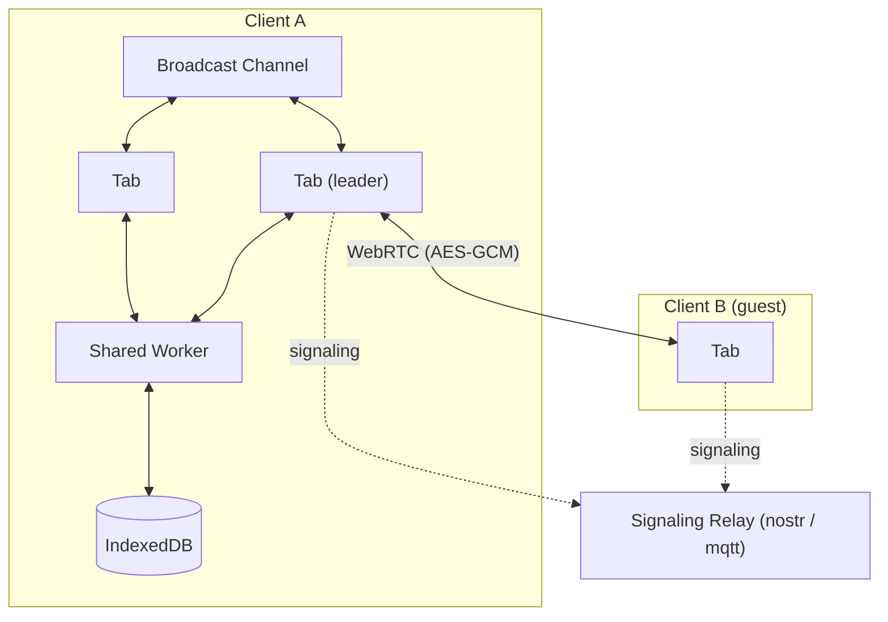

# ERD Editor

> データベーススキーマを視覚的に設計：ブラウザーで、IDE で、あるいはコーディングエージェントに頼んで

[English](./README.md) | [한국어](./README.ko.md) | [中文](./README.zh-CN.md) | 日本語

**[erd-editor.io を開く](https://erd-editor.io)** — ブラウザーでインストールなしにすぐ使えます。[VS Code](https://marketplace.visualstudio.com/items?itemName=dineug.vuerd-vscode)、[JetBrains IDE](https://plugins.jetbrains.com/plugin/23594-erd-editor)、[Obsidian](https://community.obsidian.md/plugins/erd-editor)、[Google Drive](https://workspace.google.com/marketplace/app/erd_editor/428467403360) 向けもあります。

<picture>
  <source media="(prefers-color-scheme: dark)" srcset="https://github.com/dineug/erd-editor/blob/main/img/erd-editor-vscode-dark.png?raw=true">
  
</picture>

どこで作業しても、エディターはひとつ、ファイルは `.erd.json` ひとつ。Web、Google Drive、VS Code、JetBrains IDE、Obsidian、自分のアプリの中、そしてコーディングエージェントの手の中でも。

## 機能

- **設計** — テーブル、列、メモ、テーブルグループ、4 種類のリレーションシップのカーディナリティ、ON DELETE と ON UPDATE、代替キー、自動レイアウト
- **インポート** — SQL DDL、GraphQL SDL、DBML、AML。図を置き換えることも、既存の図に追加することもできます
- **エクスポート** — 8 種類のデータベースの DDL、22 の言語・ORM のコード、PNG と SVG
- **ナビゲーション** — コマンドパレット（`Ctrl`/`Cmd`+`K`）、検索と置換を備えたエクスプローラーツリー、Graph ビューと Flow ビュー
- **履歴** — 元に戻す・やり直し、編集セッションを巻き戻すタイムトラベル、別のファイルと比べる差分ビューアー
- **25 言語**、そしてグレーとアクセントカラーを選べる System・Light・Dark テーマ
- **共同編集** — erd-editor.io のリアルタイムセッション、そしてそばで一緒に編集する[コーディングエージェント](#コーディングエージェント)

**データベース:** Databricks, MariaDB, MSSQL, MySQL, Oracle, PostgreSQL, Snowflake, SQLite

**コード:** TypeScript, GraphQL, C#, Java, JPA, Kotlin, Scala, Go, SQLAlchemy, TypeORM, Sequelize, Drizzle, DBML, AML, Mermaid, PHP, Doctrine, Rust, SeaORM, Swift, Zod, JSON Schema

各機能の使い方は[編集ガイド](https://docs.erd-editor.io/docs/category/guides)にあります。

## コーディングエージェント

Claude Code、Codex などの MCP クライアントにスキーマの変更を頼み、キャンバス上で変わっていく様子を見てください。


[`@dineug/erd-editor-mcp`](./packages/mcp-server) は、編集操作ごとにひとつのツールをエージェントに提供します。VS Code、Obsidian、JetBrains IDE がその図を持っていれば、エージェントはもう一人の共同編集者として参加し、エージェントの元に戻す操作は自身の編集だけを戻します。エディターがなければディスク上のファイルを編集し、接続をオフにしたエディターや信頼していないワークスペース・プロジェクトでは、読み取りはできても編集は拒否されます。Node.js 22.12 以降が必要です。Claude Code なら、プロジェクトフォルダーで次を実行します:

```sh
claude mcp add --transport stdio erd-editor -- npx -y @dineug/erd-editor-mcp
```

Codex やその他のクライアントの設定とツール一覧は [README](./packages/mcp-server) にあります。

## 使える場所

| | インストール | |
| --- | --- | --- |
| **Web アプリ** | [erd-editor.io](https://erd-editor.io) | オフラインでも動くインストール可能な PWA、リアルタイム共同編集 |
| **Google Drive** | [Google Workspace Marketplace](https://workspace.google.com/marketplace/app/erd_editor/428467403360) | Drive の「アプリで開く」と「新規」メニュー、同じファイルに保存し直し |
| **VS Code** | [Marketplace](https://marketplace.visualstudio.com/items?itemName=dineug.vuerd-vscode) | `.erd.json` ファイルを開きます |
| **IntelliJ** | [JetBrains Marketplace](https://plugins.jetbrains.com/plugin/23594-erd-editor) | IntelliJ 系 IDE で `.erd.json` ファイルを開きます |
| **Obsidian** | [コミュニティプラグイン](https://community.obsidian.md/plugins/erd-editor) | 保管庫の `.erd` と `.erd.json` ファイルを開きます。デスクトップ専用 |
| **自分のアプリ** | `npm install @dineug/erd-editor` | フレームワーク不要の `<erd-editor>` カスタム要素 |
| **コーディングエージェント** | [`@dineug/erd-editor-mcp`](./packages/mcp-server) | Claude Code、Codex などの MCP クライアント向けサーバー |

IDE では、拡張子 `.erd.json` の空ファイルを作って開きます。Obsidian では **ERD Editor: Create new diagram** を実行し、Google Drive では **新規 → その他 → ERD Editor** を選びます。

## リアルタイム共同編集

ERD Editor はすべての編集をアクションのストリームとしてやり取りします。そのため、ブラウザーのタブや分割したエディターなど、ひとつの図を複数の場所で開いても同期し、コーディングエージェントももう一人の共同編集者として参加できます。

[erd-editor.io](https://erd-editor.io) では、サイドバーにある共同編集ボタンから **セッションを開始** を選んでリンクを共有すると、リンクを開いた全員が一緒に編集できます。リンクが唯一の鍵なので、編集を任せてよい相手にだけ共有してください。セッションはホストのブラウザーにあり、ホストが最後のタブを閉じると終わるので、図が必要なゲストは先にエクスポートしておきます。

ピアは WebRTC で接続し、図とすべての編集は AES-GCM で暗号化されます。シグナリングリレーは平文を見ることがなく、ルームの鍵は、ブラウザーがどのリクエストにも含めない URL フラグメントにあります。

<details>
<summary>アーキテクチャ</summary>



</details>

## 組み込み

```sh
npm install @dineug/erd-editor
```

```js
import '@dineug/erd-editor';

const editor = document.createElement('erd-editor');
// エディターはコンテナーいっぱいに広がり、カスタム要素は既定で inline です
Object.assign(editor.style, { display: 'block', width: '100%', height: '100vh' });
document.body.appendChild(editor);
```

どのフレームワークからでも、フレームワークなしでも使えます。属性と要素の API は [`packages/erd-editor`](./packages/erd-editor) を参照してください。

## ドキュメント

- [編集ガイド](https://docs.erd-editor.io/docs/category/guides) — エディターのすべての機能
- [要素 API](https://docs.erd-editor.io/docs/api/erd-editor-element) — 自分のアプリに組み込む `<erd-editor>`
- [MCP](https://docs.erd-editor.io/docs/mcp/introduction) — MCP サーバーとツール
- [ドキュメント](https://docs.erd-editor.io)

## パッケージ

pnpm ワークスペースです。[`@dineug/erd-editor`](./packages/erd-editor) と [`@dineug/erd-editor-mcp`](./packages/mcp-server) は npm に公開され、3 つのプラグインはそれぞれのストアで配布され、`app` は erd-editor.io で、残りはそれらのビルドが取り込む非公開のライブラリーです。

<details>
<summary>全 18 パッケージ</summary>

| フォルダー | npm 名 | 説明 |
| --- | --- | --- |
| [`erd-editor`](./packages/erd-editor) | `@dineug/erd-editor` | エディターのコア: `<erd-editor>` カスタム要素と、ヘッドレスの `engine.js`、`peer.js` エントリー |
| [`erd-editor-schema`](./packages/erd-editor-schema) | `@dineug/erd-editor-schema` | v2/v3 ドキュメントスキーマ、パース、シリアライザー、クエリ、LWW 演算子 |
| [`schema-sql-parser`](./packages/schema-sql-parser) | `@dineug/schema-sql-parser` | SQL インポートに使う寛容な DDL パーサー |
| [`uuid`](./packages/uuid) | `@dineug/uuid` | UUIDv7 と Uuid25 エンコーディング。エディターが発行する id |
| [`r-html`](./packages/r-html) | `@dineug/r-html` | エディターの基盤となるタグ付きテンプレートのレンダリングフレームワークとストア |
| [`vite-plugin-r-html`](./packages/vite-plugin-r-html) | `@dineug/vite-plugin-r-html` | JSX → タグ付きテンプレート、および HMR 境界 |
| [`app`](./packages/app) | `@dineug/erd-editor-app` | erd-editor.io の React PWA。`/gdrive` の Google Drive エディターを含み、その OAuth リレーは `functions/` の Pages Function |
| [`vscode-extension`](./packages/vscode-extension) | `vuerd-vscode` | 公開中の VS Code 拡張機能と、コーディングエージェントハブの拡張機能側 |
| [`vscode-webview`](./packages/vscode-webview) | `@dineug/erd-editor-vscode-webview` | VS Code の Webview 内のバンドル |
| [`webview-client`](./packages/webview-client) | `@dineug/erd-editor-webview-client` | IDE の Webview に組み込んだエディター。ホストプロトコル配線済みで、両 IDE バンドルが共有 |
| [`webview-bridge`](./packages/webview-bridge) | `@dineug/erd-editor-webview-bridge` | 型付きのホスト ↔ Webview コマンドプロトコル |
| [`replication-store-worker`](./packages/replication-store-worker) | `@dineug/erd-editor-replication-store-worker` | Worker 内のヘッドレスなドキュメントレプリカ。IDE の Webview と Obsidian プラグインが保存する内容をシリアライズ |
| [`intellij-webview`](./packages/intellij-webview) | `@dineug/erd-editor-intellij-webview` | IntelliJ プラグインのエディターパネル内のバンドル |
| [`intellij-plugin`](./packages/intellij-plugin) | `@dineug/erd-editor-intellij-plugin` | 公開中の IntelliJ プラグイン。Kotlin と Gradle 製で、コーディングエージェント用の Kotlin ハブを持つ |
| [`obsidian-plugin`](./packages/obsidian-plugin) | `@dineug/erd-editor-obsidian-plugin` | Obsidian プラグイン。[erd-editor-obsidian-plugin](https://github.com/dineug/erd-editor-obsidian-plugin) からリリース |
| [`agent-hub`](./packages/agent-hub) | `@dineug/erd-editor-agent-hub` | エディターのウィンドウとコーディングエージェントの MCP サーバーの間のプロトコル: メッセージ、ロックファイル、フレーミング |
| [`agent-hub-host`](./packages/agent-hub-host) | `@dineug/erd-editor-agent-hub-host` | そのプロトコルのエディターウィンドウ側。VS Code 拡張機能と Obsidian プラグインが共有し、IntelliJ プラグインは Kotlin に移植 |
| [`mcp-server`](./packages/mcp-server) | `@dineug/erd-editor-mcp` | 公開中の MCP サーバー。VS Code、Obsidian、JetBrains IDE ではライブに、それ以外ではファイルに対してヘッドレスで動作 |

</details>

## 開発

Node 22.22.1+、24.11+ または 26+（`.nvmrc` は `22.23.2` を固定）、pnpm `10.34.3`、Git 2.32+ が必要で、IntelliJ プラグインには JDK 17+ も必要です。

```sh
pnpm install
pnpm --filter @dineug/erd-editor exec playwright install --with-deps chromium # pnpm test 用
pnpm --filter @dineug/erd-editor-app dev # Web アプリ
pnpm check # フォーマット、リント
pnpm test  # 全パッケージの型チェックとスペック
pnpm build
```

IntelliJ プラグインは [`packages/intellij-plugin`](./packages/intellij-plugin) で Gradle を使ってビルドし、e2e スイートは `pnpm test` とは別に実行します。変更ごとに実行するチェック、カバレッジ、e2e スイート、コミットのルールは [AGENTS.md](./AGENTS.md) にあります。

## コントリビューション

[Issue](https://github.com/dineug/erd-editor/issues) とプルリクエストを歓迎します。コミットメッセージは [Conventional Commits](https://www.conventionalcommits.org/) に従います。

## ライセンス

[MIT](./LICENSE) © SeungHwan-Lee
