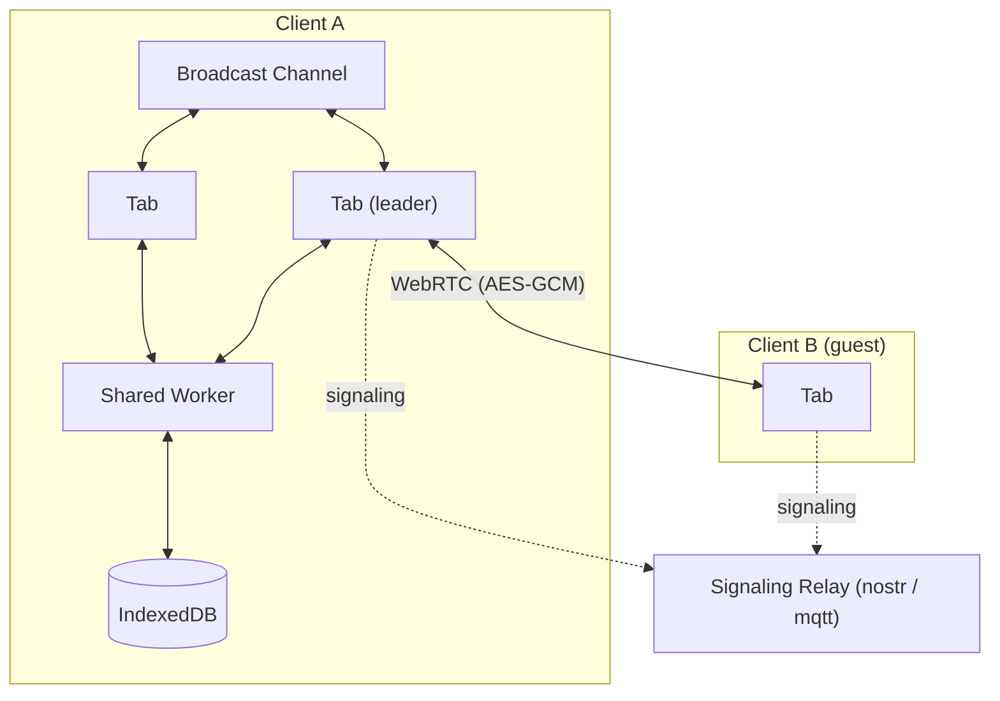

# ERD Editor

> 데이터베이스 스키마를 눈으로 보며 설계하세요: 브라우저에서, IDE에서, 또는 코딩 에이전트에게 맡겨서

[English](./README.md) | 한국어 | [中文](./README.zh-CN.md) | [日本語](./README.ja.md)

**[erd-editor.io 열기](https://erd-editor.io)** — 브라우저에서 설치 없이 바로 쓰거나,
[VS Code](https://marketplace.visualstudio.com/items?itemName=dineug.vuerd-vscode),
[JetBrains IDE](https://plugins.jetbrains.com/plugin/23594-erd-editor),
[Obsidian](https://community.obsidian.md/plugins/erd-editor),
[Google Drive](https://workspace.google.com/marketplace/app/erd_editor/428467403360)용으로 설치하세요.

<picture>
  <source media="(prefers-color-scheme: dark)" srcset="https://github.com/dineug/erd-editor/blob/main/img/erd-editor-vscode-dark.png?raw=true">
  
</picture>

어디서 작업하든 편집기 하나, `.erd.json` 파일 하나: 웹, Google Drive, VS Code, JetBrains IDE,
Obsidian, 여러분의 앱 안, 그리고 코딩 에이전트의 손에서도.

## 기능

- **설계** — 테이블, 컬럼, 메모, 테이블 그룹, 네 가지 관계 카디널리티, ON DELETE와 ON UPDATE,
  대체 키, 자동 배치
- **명명 표준** — 논리명과 물리명, 단어·용어·도메인 사전에서 정해지는 물리명과 데이터 타입, CSV
  가져오기·내보내기와 검사를 갖춘 사전 탭
- **가져오기** — SQL DDL, GraphQL SDL, DBML, AML. 다이어그램을 바꾸거나 기존 다이어그램에 더합니다
- **내보내기** — 데이터베이스 8종의 DDL, 22개 언어·ORM의 코드, PNG와 SVG
- **탐색** — 명령 팔레트(`Ctrl`/`Cmd`+`K`), 찾기·바꾸기가 있는 탐색기 트리, Graph와 Flow 뷰
- **기록** — 실행 취소와 다시 실행, 편집 세션을 되감는 타임 트래블, 다른 파일과 비교하는 Diff 뷰어
- **25개 언어**, 그리고 회색·강조색을 고르는 System·Light·Dark 테마
- **협업** — erd-editor.io의 실시간 세션, 그리고 옆에서 함께 편집하는 [코딩 에이전트](#코딩-에이전트)

**데이터베이스:** Databricks, MariaDB, MSSQL, MySQL, Oracle, PostgreSQL, Snowflake, SQLite

**코드:** TypeScript, GraphQL, C#, Java, JPA, Kotlin, Scala, Go, SQLAlchemy, TypeORM, Sequelize,
Drizzle, DBML, AML, Mermaid, PHP, Doctrine, Rust, SeaORM, Swift, Zod, JSON Schema

기능별 사용법은 [편집 가이드](https://docs.erd-editor.io/docs/category/guides)에 있습니다.

## 코딩 에이전트

Claude Code, Codex 등 MCP 클라이언트에게 스키마 변경을 부탁하고, 캔버스에서 바뀌는 모습을 지켜보세요.


[`@dineug/erd-editor-mcp`](./packages/mcp-server)는 에이전트에게 편집 작업마다 도구 하나를 줍니다.
VS Code, Obsidian, JetBrains IDE가 그 다이어그램을 갖고 있으면 에이전트는 협업자 한 명으로 참여하고,
에이전트의 실행 취소는 자기 편집만 되돌립니다. 편집기가 없으면 디스크의 파일을 편집하고, 연결을
끈 편집기나 신뢰하지 않은 워크스페이스·프로젝트에서는 읽기만 하고 편집은 거부됩니다. Node.js
22.12 이상이 필요합니다. 프로젝트 폴더에서 명령 한 줄로 추가하세요:

```sh
# Claude Code
claude mcp add --transport stdio erd-editor -- npx -y @dineug/erd-editor-mcp
# Codex
codex mcp add erd-editor -- npx -y @dineug/erd-editor-mcp
```

다른 클라이언트 설정과 도구 목록은 [README](./packages/mcp-server)에 있습니다.

## 어디서 쓸 수 있나

| | 설치 | |
| --- | --- | --- |
| **웹 앱** | [erd-editor.io](https://erd-editor.io) | 오프라인에서도 동작하는 설치형 PWA, 실시간 협업 |
| **Google Drive** | [Google Workspace Marketplace](https://workspace.google.com/marketplace/app/erd_editor/428467403360) | Drive의 연결 앱과 새로 만들기 메뉴, 같은 파일에 다시 저장 |
| **VS Code** | [Marketplace](https://marketplace.visualstudio.com/items?itemName=dineug.vuerd-vscode) | `.erd.json` 파일을 엽니다 |
| **IntelliJ** | [JetBrains Marketplace](https://plugins.jetbrains.com/plugin/23594-erd-editor) | IntelliJ 계열 IDE에서 `.erd.json` 파일을 엽니다 |
| **Obsidian** | [커뮤니티 플러그인](https://community.obsidian.md/plugins/erd-editor) | 보관소의 `.erd`와 `.erd.json` 파일을 엽니다. 데스크톱 전용 |
| **직접 만든 앱** | `npm install @dineug/erd-editor` | 프레임워크가 필요 없는 `<erd-editor>` 커스텀 엘리먼트와 읽기 전용 `<erd-viewer>` |
| **코딩 에이전트** | [`@dineug/erd-editor-mcp`](./packages/mcp-server) | Claude Code, Codex 등 MCP 클라이언트용 서버 |

IDE에서는 확장자가 `.erd.json`인 빈 파일을 만들어 여세요. Obsidian에서는
**ERD Editor: Create new diagram**을 실행하고, Google Drive에서는 **새로 만들기 → 더보기 → ERD
Editor**를 고릅니다.

## 실시간 협업

ERD Editor는 모든 편집을 액션 스트림으로 주고받습니다. 그래서 브라우저 탭이나 분할한 편집기처럼 한
다이어그램을 여러 곳에서 열어도 동기화되고, 코딩 에이전트도 협업자 한 명으로 참여합니다.

[erd-editor.io](https://erd-editor.io) 사이드바의 협업 버튼에서 **세션 시작**을 고르고 링크를
공유하면, 링크를 연 모두가 함께 편집합니다. 링크가 유일한 열쇠이니 편집을 맡길 사람에게만
공유하세요. 세션은 호스트의 브라우저에 있고 호스트가 마지막 탭을 닫으면 끝나므로, 다이어그램이 필요한
게스트는 먼저 내보내야 합니다.

피어는 WebRTC로 연결되고, 다이어그램과 모든 편집은 AES-GCM으로 암호화됩니다. 시그널링 릴레이는 평문을
보지 못하고, 방 키는 브라우저가 어떤 요청에도 넣지 않는 URL 프래그먼트에 있습니다.

<details>
<summary>구조</summary>



</details>

## 임베딩

```sh
npm install @dineug/erd-editor
```

```js
import '@dineug/erd-editor/erd-editor.js';

const editor = document.createElement('erd-editor');
// 편집기는 컨테이너를 채우고, 커스텀 엘리먼트는 기본이 inline입니다
Object.assign(editor.style, { display: 'block', width: '100%', height: '100vh' });
document.body.appendChild(editor);
```

편집하지 않고 다이어그램을 보여 주기만 하려면 `@dineug/erd-editor/erd-viewer.js`를 가져오고
`<erd-viewer src="diagram.erd.json" style="display: block; height: 480px"></erd-viewer>`를
두세요. 스타일로 정한 상자 안에서 다이어그램을 이동하고 확대하고 검색할 수 있습니다. 패키지 루트를
가져오는 것만으로는 어느 엘리먼트도 정의되지 않습니다.

어떤 프레임워크에서도, 프레임워크 없이도 동작합니다. 속성과 엘리먼트 API는
[`packages/erd-editor`](./packages/erd-editor)를 보세요.

## 문서

- [편집 가이드](https://docs.erd-editor.io/docs/category/guides) — 편집기의 모든 기능
- [엘리먼트 API](https://docs.erd-editor.io/docs/api/erd-editor-element) — 여러분의 앱에 넣는
  `<erd-editor>`; `<erd-viewer>`는 [`packages/erd-editor`](./packages/erd-editor)를 보세요
- [MCP](https://docs.erd-editor.io/docs/mcp/introduction) — MCP 서버와 도구
- [문서](https://docs.erd-editor.io)

## 패키지

pnpm 워크스페이스입니다. [`@dineug/erd-editor`](./packages/erd-editor)와
[`@dineug/erd-editor-mcp`](./packages/mcp-server)는 npm에 게시되고, 플러그인 셋은 각자의 스토어로
배포되며, `app`은 erd-editor.io이고, 나머지는 이 빌드들이 가져다 쓰는 비공개 라이브러리입니다.

<details>
<summary>20개 패키지 전체</summary>

| 폴더 | npm 이름 | 설명 |
| --- | --- | --- |
| [`erd-editor`](./packages/erd-editor) | `@dineug/erd-editor` | 편집기 코어: `<erd-editor>` 커스텀 엘리먼트, 읽기 전용 `<erd-viewer>`, 헤드리스 `engine.js`·`peer.js` 진입점 |
| [`erd-editor-schema`](./packages/erd-editor-schema) | `@dineug/erd-editor-schema` | v2/v3 문서 스키마, 파싱, 직렬화, 조회, LWW 연산자 |
| [`schema-sql-parser`](./packages/schema-sql-parser) | `@dineug/schema-sql-parser` | SQL 가져오기에 쓰는 관대한 DDL 파서 |
| [`uuid`](./packages/uuid) | `@dineug/uuid` | UUIDv7과 Uuid25 인코딩, 편집기가 만드는 id |
| [`r-html`](./packages/r-html) | `@dineug/r-html` | 편집기의 바탕인 태그드 템플릿 렌더링 프레임워크와 스토어 |
| [`vite-plugin-r-html`](./packages/vite-plugin-r-html) | `@dineug/vite-plugin-r-html` | JSX → 태그드 템플릿 변환과 HMR 경계 |
| [`r-html-konva`](./packages/r-html-konva) | `@dineug/r-html-konva` | 편집기의 캔버스가 렌더링을 거치는, r-html 템플릿의 Konva 호스트 |
| [`grid`](./packages/grid) | `@dineug/grid` | 보이는 셀만 그리는, `r-html-konva` 위의 Konva 캔버스 스프레드시트 그리드 |
| [`app`](./packages/app) | `@dineug/erd-editor-app` | erd-editor.io의 React PWA. `/gdrive`의 Google Drive 편집기를 포함하며, 그 OAuth 릴레이는 `functions/`의 Pages Function |
| [`vscode-extension`](./packages/vscode-extension) | `vuerd-vscode` | 게시된 VS Code 확장과 코딩 에이전트 허브의 확장 쪽 |
| [`vscode-webview`](./packages/vscode-webview) | `@dineug/erd-editor-vscode-webview` | VS Code 웹뷰 안의 번들 |
| [`webview-client`](./packages/webview-client) | `@dineug/erd-editor-webview-client` | IDE 웹뷰에 올린 편집기. 호스트 프로토콜이 연결되어 있고 두 IDE 번들이 공유 |
| [`webview-bridge`](./packages/webview-bridge) | `@dineug/erd-editor-webview-bridge` | 타입이 있는 호스트 ↔ 웹뷰 명령 프로토콜 |
| [`replication-store-worker`](./packages/replication-store-worker) | `@dineug/erd-editor-replication-store-worker` | Worker 안의 헤드리스 문서 복제본. IDE 웹뷰와 Obsidian 플러그인이 저장할 내용을 직렬화 |
| [`intellij-webview`](./packages/intellij-webview) | `@dineug/erd-editor-intellij-webview` | IntelliJ 플러그인 편집기 패널 안의 번들 |
| [`intellij-plugin`](./packages/intellij-plugin) | `@dineug/erd-editor-intellij-plugin` | 게시된 IntelliJ 플러그인. Kotlin과 Gradle로 만들며 코딩 에이전트용 Kotlin 허브를 따로 가짐 |
| [`obsidian-plugin`](./packages/obsidian-plugin) | `@dineug/erd-editor-obsidian-plugin` | Obsidian 플러그인. [erd-editor-obsidian-plugin](https://github.com/dineug/erd-editor-obsidian-plugin)에서 릴리스 |
| [`agent-hub`](./packages/agent-hub) | `@dineug/erd-editor-agent-hub` | 편집기 창과 코딩 에이전트의 MCP 서버 사이 프로토콜: 메시지, 잠금 파일, 프레이밍 |
| [`agent-hub-host`](./packages/agent-hub-host) | `@dineug/erd-editor-agent-hub-host` | 그 프로토콜의 편집기 창 쪽. VS Code 확장과 Obsidian 플러그인이 공유하고, IntelliJ 플러그인은 Kotlin으로 이식 |
| [`mcp-server`](./packages/mcp-server) | `@dineug/erd-editor-mcp` | 게시된 MCP 서버. VS Code, Obsidian, JetBrains IDE에서는 실시간으로, 그 밖에는 파일에 헤드리스로 동작 |

</details>

## 개발

Node 22.22.1+, 24.11+ 또는 26+(`.nvmrc`는 `22.23.2` 고정), pnpm `10.34.3`, Git 2.32+가 필요하고,
IntelliJ 플러그인에는 JDK 17+도 필요합니다.

```sh
pnpm install
pnpm --filter @dineug/erd-editor exec playwright install --with-deps chromium # pnpm test용
pnpm --filter @dineug/erd-editor-app dev # 웹 앱
pnpm check # 포맷, 린트
pnpm test  # 모든 패키지의 타입 검사와 스펙
pnpm build
```

IntelliJ 플러그인은 [`packages/intellij-plugin`](./packages/intellij-plugin)에서 Gradle로 빌드하고,
e2e 스위트는 `pnpm test`와 따로 돕니다. 변경마다 돌릴 검사, 커버리지, e2e 스위트, 커밋 규칙은
[AGENTS.md](./AGENTS.md)에 있습니다.

## 기여

[이슈](https://github.com/dineug/erd-editor/issues)와 풀 리퀘스트를 환영합니다. 커밋 메시지는
[Conventional Commits](https://www.conventionalcommits.org/)를 따릅니다.

## 라이선스

[MIT](./LICENSE) © SeungHwan-Lee
