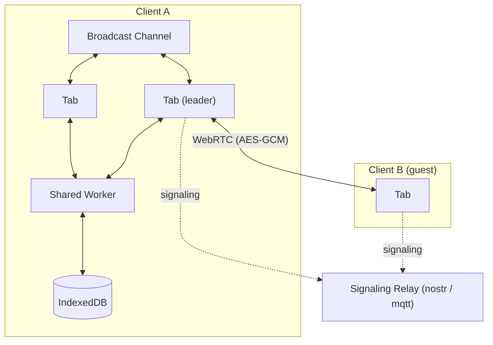

# ERD Editor

> 엔터티 관계 다이어그램 편집기

[English](./README.md) | 한국어 | [中文](./README.zh-CN.md) | [日本語](./README.ja.md)


데이터베이스 스키마를 눈으로 보며 설계하고, 이미 있는 스키마는 SQL DDL, GraphQL SDL, DBML, AML에서
가져오고, DDL이나 생성된 코드로 내보냅니다. ERD Editor는 erd-editor.io, Google Drive, VS Code,
IntelliJ 계열 IDE, Obsidian, 그리고 여러분의 페이지에 넣는 커스텀 엘리먼트까지 하나의 편집기와 하나의
파일 형식이며, 코딩 에이전트는 MCP 서버를 통해 같은 다이어그램을 편집합니다.

## 어디서 쓸 수 있나

| | 설치 | |
| --- | --- | --- |
| **웹 앱** | [erd-editor.io](https://erd-editor.io) | 설치할 수 있는 PWA. 오프라인에서도 실행되고 실시간 협업을 지원합니다 |
| **Google Drive** | [Google Workspace Marketplace](https://workspace.google.com/marketplace/app/erd_editor/428467403360) | Drive의 연결 앱과 새로 만들기 메뉴에 ERD Editor를 추가하고, 같은 파일에 다시 저장합니다 |
| **VS Code** | [Marketplace](https://marketplace.visualstudio.com/items?itemName=dineug.vuerd-vscode) | `.erd.json` 파일을 커스텀 편집기로 엽니다 |
| **IntelliJ** | [JetBrains Marketplace](https://plugins.jetbrains.com/plugin/23594-erd-editor) | IntelliJ 계열 IDE에서 같은 방식으로 엽니다 |
| **Obsidian** | [커뮤니티 플러그인](https://community.obsidian.md/plugins/erd-editor) | `.erd`와 `.erd.json` 파일을 보관소 탭에서 엽니다. 데스크톱 전용 |
| **직접 만든 앱** | `npm install @dineug/erd-editor` | 프레임워크에 묶이지 않은 `<erd-editor>` 커스텀 엘리먼트 |
| **코딩 에이전트** | [`@dineug/erd-editor-mcp`](#코딩-에이전트) | Claude Code, Codex 등 MCP 클라이언트용 서버. VS Code, JetBrains IDE, Obsidian에서는 실시간으로, 그 밖에는 파일을 직접 편집합니다 |

IDE에서 써 보려면 확장자가 `.erd.json`인 빈 파일을 만들어 여세요. Obsidian에서는 Obsidian의 명령
팔레트에서 **ERD Editor: Create new diagram**을 실행합니다. Google Drive에서는
**새로 만들기 → 더보기 → ERD Editor**를 고릅니다.

## 기능

### 설계

- **시각적 스키마 설계** — 테이블, 컬럼, 메모, 그리고 네 가지 관계 카디널리티(Zero One, Zero N,
  One Only, One N)
- **빠른 편집** — `Alt`+`N`으로 테이블을, `Alt`+`Enter`로 컬럼을 추가하고, `Alt`+`K`는 포커스된 컬럼의
  기본 키를 켜고 끄며(그 컬럼이 선택에 들어 있으면 선택한 모든 컬럼에), `Delete`나 `Backspace`는 선택
  항목을 지웁니다. 각각 실행 취소 한 번으로 되돌릴 수 있고, 플로팅 툴바에서 테이블·메모·테이블 그룹을
  추가할 수 있으며, 편집기 설정 탭의 단축키 페이지에 모든 키가 있습니다
- **기존 컬럼 잇기** — 마우스나 펜으로 관계를 그릴 때 끝나는 테이블 옆에 뜨는 버튼으로, 부모의 키를
  그 테이블에 이미 있는 컬럼에 매핑하거나 새 컬럼을 추가합니다. 새 컬럼은 키가 한 단어이면 부모 테이블
  이름을 붙여 짓고(`user`의 `id`는 `user_id`), 관계의 오른쪽 클릭 메뉴에 있는 **컬럼 매핑**으로 나중에
  바꿀 수 있습니다
- **참조 동작** — 관계의 오른쪽 클릭 메뉴에서 **ON DELETE**와 **ON UPDATE**(NO ACTION, CASCADE,
  SET NULL, SET DEFAULT, RESTRICT)를 정합니다. 현재 데이터베이스가 지원하지 않는 값은 표시해 주고,
  관계선의 자식 쪽 끝에 `D:C U:R`처럼 보이며, 보기 옵션의 참조 동작으로 라벨을 숨길 수 있습니다.
  SQL·DBML·AML 가져오기가 이를 읽고, DDL 내보내기와 이를 담을 자리가 있는 코드 생성기는 대상이
  지원하는 값을 씁니다
- **대체 키** — 보기 옵션의 대체 키를 켜면 두 개 이상의 컬럼에 걸친 고유 인덱스의 컬럼마다 `AK1.1`,
  `AK1.2`처럼 표시하고, SQL 가져오기는 여러 컬럼에 걸친 UNIQUE를 그런 인덱스 하나로 읽습니다
- **테이블 그룹** — 캔버스 메뉴·명령 팔레트·플로팅 툴바의 **새 테이블 그룹**이나 `Alt`+`G`로 관련
  테이블 뒤에 상자를 그리고 이름과 색을 붙이거나, 선택한 테이블의 오른쪽 클릭 메뉴나 `T` 다음 `G`로
  그룹으로 묶습니다. 테이블을 상자 안에 놓으면 그룹에 들어가고 밖에 놓으면 나오며, 제목을 잡아 끌면
  그룹의 테이블이 함께 움직이고, 각 멤버의 헤더는 그룹의 색을 띠고, 보기 옵션으로 그룹을 숨길 수
  있으며, DBML 가져오기와 코드 생성기의 DBML은 그룹을 `TableGroup`으로 다룹니다
- **자동 배치** — 캔버스 메뉴나 명령 팔레트에서 힘 기반, 흐름, 세로 또는 가로 트리로 모든 테이블을
  다시 배치합니다. 테이블 그룹은 함께 움직이고 실행 취소 한 번으로 되돌립니다. 힘 기반은 적용하거나
  취소할 미리보기를 보여 주고, 나머지는 바로 적용됩니다
- **복사, 붙여넣기, 색상** — 테이블과 메모를 복사해 새 항목으로 붙여넣습니다. 다른 다이어그램에도
  붙일 수 있고 스프레드시트에는 표 형태로 붙으며, `Alt`를 누른 채 끌면 복제됩니다. 테이블·메모·테이블
  그룹의 색은 오른쪽 클릭 메뉴에서 정합니다
- **깨끗한 diff** — 스크롤 위치와 확대 비율, 열려 있는 탭, 코드 생성기의 언어와 이름 표기법, 괄호
  유형은 기본으로 잠겨 있어 파일은 잠글 때의 값을 유지하고, 둘러보기만 해서는 파일이 바뀌지 않습니다.
  파일은 정해진 순서로 쓰이며 측정된 너비, 관계선 앵커, 삭제된 항목은 담지 않습니다

### 가져오기

- **SQL DDL 가져오기** — 아래 여덟 가지 데이터베이스의 `.sql` 덤프를 가져옵니다. 파서는 `CREATE TABLE`,
  `CREATE INDEX`, `ALTER TABLE` 제약 조건과 테이블·컬럼 주석(`COMMENT ON`, SQL Server의
  `sp_addextendedproperty`)을 읽고 모르는 구문은 건너뛰므로, 까다로운 덤프도 통째로 실패하지 않고
  읽을 수 있는 만큼 가져옵니다
- **GraphQL SDL 가져오기** — SDL을 내보내는 어떤 도구의 스키마든 가져옵니다. 객체 타입은 테이블이
  되고, 스칼라는 다이어그램의 데이터 타입으로 대응되며, 다른 타입을 가리키는 필드는 관계가 됩니다. 루트
  타입과 Relay, Federation, Hasura가 생성하는 래퍼 타입은 테이블로 그리지 않고 뺍니다
- **DBML 가져오기** — dbdiagram.io나 dbdocs.io용으로 쓴 `.dbml` 파일, 또는 `sql2dbml`이나
  `prisma-dbml-generator`가 내보낸 파일을 가져옵니다. 테이블, 컬럼, 인덱스, enum, 헤더 색, 모든 `Ref`
  표기, 각 `TableGroup`이 들어오고, `Project`나 스티키 `Note`는 거부하지 않고 건너뜁니다
- **AML 가져오기** — [Azimutt](https://azimutt.app)용 `.aml` 파일을 v2와 옛 v1 표기 모두 가져옵니다.
  엔터티, 속성, 인덱스, enum, 색, 모든 관계 화살표가 들어오고, check와 struct 타입은 거부하지 않고
  건너뛰며, view는 테이블로 들어옵니다
- **가져오면 바로 배치** — 가져오기 메뉴, 명령 팔레트, 호스트의 파일 대화상자로 고른 스키마는
  테이블이 관계에 따라 배치된 채(관계가 없으면 줄 맞춰) 들어오고, 실행 취소 한 번으로 이전 다이어그램이
  돌아옵니다. erd-editor.io의 스키마 목록이나 Google Drive 편집기로 가져온 SQL·DBML·AML·GraphQL
  파일은 같은 방식으로 배치된 새 다이어그램이 됩니다
- **가져와서 추가** — 가져오기 옆의 메뉴와 명령 팔레트의 다섯 형식으로, `.sql`, GraphQL, DBML, AML,
  `.erd.json` 파일을 다이어그램을 바꾸는 대신 더합니다. 테이블은 이미 있는 것들 아래에 같은 방식으로
  배치되어(`.erd.json` 파일은 자기 배치를 유지) 선택된 채 들어오고, 실행 취소 한 번으로 사라집니다.
  이름이 이미 있는 테이블은 합쳐지지 않고 두 번째 테이블로 들어오며, 파일 밖의 테이블을 가리키는 외래
  키는 버립니다

### 내보내기와 코드

- **SQL DDL 내보내기** — Databricks, MariaDB, MSSQL, MySQL, Oracle, PostgreSQL, Snowflake, SQLite.
  스키마 SQL 탭에서 DDL을 `.sql` 파일로 저장하거나 복사합니다
- **스키마 SQL 옵션** — DDL 옆 패널에서 데이터베이스와 괄호 유형, CREATE TABLE IF NOT EXISTS 또는 삭제
  후 재생성, `USE`나 `CREATE + USE` 머리말(데이터베이스가 지원하는 경우에만), 테이블 그룹별 테이블을
  고르고, 테이블 앞뒤에 쓸 SQL을 직접 보관합니다. 구문·머리말·테이블 선택은 이 편집기를 닫을 때까지만
  유지되고 파일에는 닿지 않으며, 스크립트는 문서에 저장됩니다
- **코드 생성** — TypeScript, GraphQL, C#, Java, JPA, Kotlin, Scala, Go, SQLAlchemy, TypeORM,
  Sequelize, Drizzle, DBML, AML, Mermaid, PHP, Doctrine, Rust, SeaORM, Swift, Zod, JSON Schema를 코드
  생성기 탭에서 만듭니다. 옵션 패널에서 언어, 데이터베이스, 테이블·컬럼 이름 표기법, 그리고
  Doctrine·JPA·SeaORM은 괄호 유형을 고르고, 코드를 그 언어의 확장자를 가진 파일로 저장합니다
- **내보내기** — `.erd.json`, `.sql`, 그리고 미리보기가 있는 대화상자에서 `.png` 또는 `.svg`: 투명
  배경, 라이트 또는 다크, PNG는 1x~3x 배율이나 클립보드 복사

### 찾기와 탐색

- **빠른 검색** — `Ctrl`/`Cmd`+`K`로 명령 팔레트를 열어 편집기 명령(새 테이블, 가져오기, 내보내기,
  자동 배치, 탭, 테마, 언어 등)을 실행하거나, `#` 뒤에 테이블, `@` 뒤에 컬럼, `:` 뒤에 주석이나 메모를
  입력해 바로 이동합니다. 한글은 초성으로도 찾습니다(`ㅅㅇㅈ`로 사용자를 찾음)
- **탐색기** — 툴바의 탐색기 버튼은 테이블과 그 컬럼·인덱스·외래 키, 테이블 그룹, 메모의 트리를
  캔버스 옆에 붙여 열고, 행을 클릭하면 그 대상으로 이동합니다. `Ctrl`/`Cmd`+`F`로 테이블·컬럼·인덱스·그룹
  이름, 주석, 메모를 대/소문자 구분, 단어 단위, 정규식, 대/소문자 보존으로 찾고, 모두 바꾸기는 실행 취소
  한 번으로 되돌립니다
- **시각화** — 그래프 모드는 테이블 사이의 관계를 힘 기반으로 그립니다. 흐름 모드는 테이블을 관계에
  따라 배치하고, 마우스를 올린 테이블과 그와 관련된 테이블을 밝히며, 이름만·키만·모든 필드 중 하나로
  보여 줍니다. 테이블의 오른쪽 클릭 메뉴에 있는 **이 테이블 중심으로 보기**는 그 테이블과 이웃만으로
  흐름 모드를 열고, 여러 테이블을 선택했을 때는 **선택한 테이블 중심으로 보기**가 선택한 테이블 전부와
  그 이웃을 보여 주며 `Alt`+`F`도 선택에 대해 같은 일을 합니다. 두 보기 모두 배치를 파일에 쓰지
  않습니다
- **확대와 이동** — 트랙패드 핀치나 두 손가락으로 확대·축소하고, 가운데 버튼 드래그로 어디서나
  이동하며, 플로팅 툴바의 배율을 클릭하면 100%로 돌아옵니다
- **시간 여행** — 툴바에서 이번 편집 세션의 기록을 캔버스에서 재생하고 아무 시점으로나 이동합니다
- **변경 내용 비교** — 캔버스 메뉴에서 다른 `.json` 파일과 다이어그램을 비교합니다. 트리가 추가·수정·
  삭제·이름 변경된 것을 나열하고, 두 화면이 캔버스에서 표시합니다
- **실행 취소 / 다시 실행** — 모든 편집을 툴바나 `Ctrl`/`Cmd`+`Z`, `Ctrl`/`Cmd`+`Shift`+`Z`로, 편집기
  자체의 기록에서 되돌립니다

### 언어와 테마

- **표시 언어** — 편집기의 메뉴, 패널, 대화상자, 명령 팔레트, 메시지를 25개 언어로 보여 주고,
  아랍어·히브리어·페르시아어는 오른쪽에서 왼쪽으로 배치하되 다이어그램은 왼쪽에서 오른쪽을 유지합니다.
  툴바의 언어 버튼이나 명령 팔레트의 **표시 언어**에서 고르거나, 기본값인 시스템을 두면 브라우저나
  호스트의 언어를 따르고 편집기에 없는 언어는 영어로 보여 줍니다. 테이블·컬럼 이름, SQL 키워드, 데이터
  타입, 생성된 코드는 그대로입니다
- **테마** — 툴바의 테마 빌더에서 모양(시스템, 라이트, 다크), 회색 계열, 강조색을 고르고, 명령 팔레트의
  **테마**는 모양을 고릅니다. 시스템은 운영체제나 호스트의 라이트·다크 테마를 따르고, 고른 값은
  erd-editor.io에서는 브라우저에, 플러그인에서는 각 플러그인의 설정에 저장되며, npm 엘리먼트는 호스트에
  맡깁니다
- **시작 화면** — 편집할 수 있는 빈 다이어그램은 새 테이블, 새 메모, 가져오기, 명령 팔레트, 단축키
  메뉴로 열리고, 캔버스에 자리가 있으면 툴바의 검색·테마·언어 버튼과 플로팅 툴바를 화살표로 가리키며,
  첫 테이블·표시된 메모·표시된 테이블 그룹이 생길 때까지 남아 있습니다. npm 엘리먼트는 호스트가 켜야 시작
  화면, 언어 선택, 테마 빌더를 보여 주고, 호스트가 언어를 정하거나 언어 선택을 켜기 전까지는 영어로
  보입니다

### 협업과 코딩 에이전트

- **실시간 협업**(실험 기능) — erd-editor.io의 사이드바에서 세션을 시작하고 링크를 공유하면, 링크를
  연 모두가 다이어그램을 함께 편집합니다. 피어 투 피어에 종단 간 암호화이고, 스키마를 보관하는 백엔드는
  없습니다. 엘리먼트를 넣어 쓰는 쪽은 `getSharedStore()`로 같은 액션 스트림을 받습니다
- **코딩 에이전트** — Claude Code, Codex 등 어떤 MCP 클라이언트든
  [`@dineug/erd-editor-mcp`](./packages/mcp-server)를 통해 다이어그램을 편집합니다. VS Code, Obsidian,
  JetBrains IDE에서는 캔버스에 실시간으로 반영되고 에이전트의 실행 취소는 자기 편집만 되돌리며,
  다이어그램을 열어 둔 편집기가 없으면 파일을 직접 편집합니다

## 임베딩

```sh
npm install @dineug/erd-editor
```

```js
import '@dineug/erd-editor';

const editor = document.createElement('erd-editor');
// 편집기는 컨테이너를 채우고, 커스텀 엘리먼트는 기본이 inline입니다
Object.assign(editor.style, { display: 'block', width: '100%', height: '100vh' });
document.body.appendChild(editor);
```

커스텀 엘리먼트이므로 어떤 프레임워크에서도, 프레임워크 없이도 동작합니다. 설치, 속성, 엘리먼트 API는
[`packages/erd-editor`](./packages/erd-editor)를 보세요.

## 실시간 협업(실험 기능)

[erd-editor.io](https://erd-editor.io)에서 스키마를 열고 사이드바의 협업 버튼에서 **Start session**을
고른 뒤 링크를 공유하세요. 링크를 연 모두가 다이어그램을 함께 편집하고, 그 편집은 여러분의 브라우저에
저장됩니다. 링크가 유일한 열쇠이니 편집을 맡길 사람에게만 공유하세요. 참가자는 닉네임을 정할 수 있고,
참가자 목록과 포인터 옆에 표시됩니다.

세션은 호스트의 브라우저에 있습니다. 게스트는 다이어그램 사본을 갖지 않고, 호스트가 마지막 탭을 닫으면
세션이 끝나므로, 다이어그램이 필요한 게스트는 먼저 내보내야 합니다.

세션은 WebRTC 피어 투 피어이고, 다이어그램과 모든 편집은 AES-GCM으로 암호화됩니다. 시그널링 릴레이는
피어를 소개만 할 뿐 평문을 보지 못합니다. 방의 비밀 키는 URL 프래그먼트에 있고 브라우저는 프래그먼트를
어떤 요청에도 넣지 않으므로, 릴레이도 erd-editor.io 서버도 키를 받지 않습니다. 호스트의 브라우저에서는
열린 탭들이 리더를 뽑아 모든 피어 연결을 맡기고, 게스트 탭은 각자 참여합니다.

<details>
<summary>구조</summary>



</details>

## 코딩 에이전트

[`@dineug/erd-editor-mcp`](./packages/mcp-server)는 Claude Code, Codex 등 MCP 클라이언트에 편집 작업마다
도구 하나를 주는 MCP 서버입니다: 테이블 추가, 컬럼 이름 바꾸기, 두 테이블 잇기, DDL 덤프 가져오기,
스키마를 SQL로 읽기. VS Code 창, Obsidian 보관소, JetBrains IDE가 그 다이어그램을 열어 두었거나
워크스페이스·보관소·프로젝트 안에 두고 있으면, 에이전트는 그 편집기에 협업자 한 명으로 참여합니다. 변경이
일어나는 대로 캔버스에 나타나고, 에이전트의 실행 취소는 자기 편집만 되돌립니다. 다이어그램을 열어 둔
편집기가 없으면 같은 도구가 디스크의 파일을 편집합니다. 연결을 끈 편집기나 신뢰하지 않은 VS Code
워크스페이스·JetBrains 프로젝트는 에이전트의 읽기는 허용하고 편집은 거부합니다. 편집기의 다음 저장이
덮어쓸 테니까요. 서버에는 Node.js 22.12 이상이 필요하고, Claude Code라면 프로젝트 폴더에서 다음을
실행합니다:

```sh
claude mcp add --transport stdio erd-editor -- npx -y @dineug/erd-editor-mcp
```

[README](./packages/mcp-server)에 Codex와 다른 클라이언트 설정, 현재 도구 목록이 있고,
[MCP 문서](https://docs.erd-editor.io/docs/mcp/introduction)는 서버 설치와 실시간·헤드리스 편집을
다룹니다.


## 문서

- [편집 가이드](https://docs.erd-editor.io/docs/category/guides) — 편집, 가져오기와 내보내기, 관계,
  빠른 검색, 시각화, 코드 생성, 설정
- [엘리먼트 API](https://docs.erd-editor.io/docs/api/erd-editor-element) — `<erd-editor>` 엘리먼트의
  API
- [MCP](https://docs.erd-editor.io/docs/mcp/introduction) — MCP 서버 설치, 실시간·헤드리스 편집, 도구
- [문서](https://docs.erd-editor.io)

## 패키지

pnpm 워크스페이스입니다. npm에 게시되는 패키지는 둘입니다: 구문 강조까지 포함한 편집기 자체인
[`@dineug/erd-editor`](./packages/erd-editor)와 코딩 에이전트용 MCP 서버인
[`@dineug/erd-editor-mcp`](./packages/mcp-server). 플러그인 셋은 각자의 스토어로 배포되고, `app`은
erd-editor.io이며, 나머지는 이 빌드들이 가져다 쓰는 비공개 라이브러리와 번들입니다.

<details>
<summary>18개 패키지 전체</summary>

| 폴더 | npm 이름 | 설명 |
| --- | --- | --- |
| [`erd-editor`](./packages/erd-editor) | `@dineug/erd-editor` | 편집기 코어: `<erd-editor>` 커스텀 엘리먼트와 헤드리스 `engine.js`·`peer.js` 진입점 |
| [`erd-editor-schema`](./packages/erd-editor-schema) | `@dineug/erd-editor-schema` | v2/v3 문서 스키마, 파싱, 직렬화, 조회, LWW 연산자 |
| [`schema-sql-parser`](./packages/schema-sql-parser) | `@dineug/schema-sql-parser` | SQL 가져오기에 쓰는 관대한 DDL 파서 |
| [`uuid`](./packages/uuid) | `@dineug/uuid` | UUIDv7과 Uuid25 인코딩, 편집기가 만드는 id |
| [`r-html`](./packages/r-html) | `@dineug/r-html` | 편집기의 바탕인 태그드 템플릿 렌더링 프레임워크와 스토어 |
| [`vite-plugin-r-html`](./packages/vite-plugin-r-html) | `@dineug/vite-plugin-r-html` | JSX → 태그드 템플릿 변환과 HMR 경계 |
| [`app`](./packages/app) | `@dineug/erd-editor-app` | erd-editor.io의 React PWA. `/gdrive`의 Google Drive 편집기를 포함하며, 그 OAuth 릴레이는 `functions/`의 Pages Function |
| [`vscode-extension`](./packages/vscode-extension) | `vuerd-vscode` | 게시된 VS Code 확장과 코딩 에이전트 허브의 확장 쪽 |
| [`vscode-webview`](./packages/vscode-webview) | `@dineug/erd-editor-vscode-webview` | VS Code 웹뷰 안의 번들 |
| [`webview-client`](./packages/webview-client) | `@dineug/erd-editor-webview-client` | IDE 웹뷰에 올린 편집기. 호스트 프로토콜이 연결되어 있고 두 IDE 번들이 공유 |
| [`webview-bridge`](./packages/webview-bridge) | `@dineug/erd-editor-webview-bridge` | 타입이 있는 호스트 ↔ 웹뷰 명령 프로토콜 |
| [`replication-store-worker`](./packages/replication-store-worker) | `@dineug/erd-editor-replication-store-worker` | Worker 안의 헤드리스 문서 복제본. IDE 웹뷰와 Obsidian 플러그인이 저장할 내용을 직렬화 |
| [`intellij-webview`](./packages/intellij-webview) | `@dineug/erd-editor-intellij-webview` | IntelliJ 플러그인 편집기 패널 안의 번들 |
| [`intellij-plugin`](./packages/intellij-plugin) | `@dineug/erd-editor-intellij-plugin` | 게시된 IntelliJ 플러그인. Kotlin과 Gradle로 만들며 코딩 에이전트용 Kotlin 허브를 따로 가짐 |
| [`obsidian-plugin`](./packages/obsidian-plugin) | `@dineug/erd-editor-obsidian-plugin` | Obsidian 플러그인. [erd-editor-obsidian-plugin](https://github.com/dineug/erd-editor-obsidian-plugin)에서 릴리스 |
| [`agent-hub`](./packages/agent-hub) | `@dineug/erd-editor-agent-hub` | 편집기 창과 코딩 에이전트의 MCP 서버 사이 프로토콜: 메시지, 잠금 파일, 프레이밍 |
| [`agent-hub-host`](./packages/agent-hub-host) | `@dineug/erd-editor-agent-hub-host` | 그 프로토콜의 편집기 창 쪽. VS Code 확장과 Obsidian 플러그인이 공유하고, IntelliJ 플러그인은 Kotlin으로 이식 |
| [`mcp-server`](./packages/mcp-server) | `@dineug/erd-editor-mcp` | 게시된 MCP 서버. VS Code, Obsidian, JetBrains IDE에서는 실시간으로, 그 밖에는 파일에 헤드리스로 동작 |

</details>

## 개발

Node는 22 계열 22.22.1 이상, 24 계열 24.11 이상, 또는 26 이상이 필요하고(`.nvmrc`는 CI가 쓰는 `22.23.2`를
고정), pre-commit 훅에는 Git 2.32 이상, 그리고 `packageManager`가 고정한 pnpm `10.34.3`이 필요합니다.
IntelliJ 플러그인은 Gradle을 돌릴 JDK 17 이상도 필요하며, 플러그인이 컴파일 대상으로 삼는 JDK 21은 없으면
Gradle의 툴체인 리졸버가 받아 옵니다.

`pnpm test`는 `erd-editor`의 브라우저 스펙을 Chromium에서 돌리므로 한 번 설치해 두세요:

```sh
pnpm install
pnpm --filter @dineug/erd-editor exec playwright install --with-deps chromium
```

```sh
pnpm check                      # 포맷·린트 검사, 루트 tsc, tools 스펙, 태스크 입력 검사
pnpm test                       # 패키지마다: 의존성 빌드, tsc --noEmit, 단위·브라우저 스펙
pnpm -r --no-bail test:coverage # 패키지마다 커버리지를 재는 스펙. CI는 pnpm test 뒤에 돌림
pnpm build                      # 모든 패키지 빌드
pnpm size                       # pnpm build 뒤: CI가 돌리는 번들 크기 검사
pnpm peer-graph                 # pnpm build 뒤: CI가 돌리는 peer.js 그래프 검사
pnpm cache:clear                # Vite Task 캐시 비우기
pnpm format                     # 포맷 수정 사항 쓰기
```

`build`와 `test` 태스크는 [Vite+](https://viteplus.dev/)를 거치며, 그 `vp` 바이너리는 `pnpm install`이
`node_modules/.bin`에 둡니다. 나머지는 package.json 스크립트입니다. 패키지는 npm 이름이나
`./packages/<폴더>`로 고릅니다.

```sh
pnpm exec vp run --filter @dineug/erd-editor --fail-if-no-match test   # 태스크
pnpm --filter @dineug/erd-editor-app dev                                # 스크립트: 웹 앱
```

`intellij-plugin`만 예외입니다. Gradle 프로젝트라 자기 디렉터리에서 빌드하고 테스트하며, package.json에는
smoke와 probe 스크립트만 있습니다. `pnpm test`는 Kotlin 쪽에 닿지 않습니다.

```sh
cd packages/intellij-plugin
./gradlew buildWebview   # 플러그인이 담는 웹뷰 번들
./gradlew runIde         # 플러그인을 올린 샌드박스 IDE
./gradlew check          # JUnit 스펙, 적합성 검사, Kover 커버리지 게이트
./gradlew buildPlugin    # 배포용 zip
```

Playwright 엔드 투 엔드 스위트와 VS Code Extension Host 스위트는 `pnpm test`에 들어 있지 않고, CI가
별도 작업으로 돌립니다.

```sh
pnpm --filter @dineug/erd-editor e2e   # @dineug/r-html, @dineug/erd-editor-app도 같은 방식
pnpm --filter vuerd-vscode e2e         # 실제 VS Code를 띄움. Linux에서는 앞에 `xvfb-run -a`
```

변경에 필요한 나머지, 어떤 검사를 돌리고 무엇을 함께 바꾸며 커밋 규칙은 무엇인지는
[AGENTS.md](./AGENTS.md)에 있습니다.

## 기여

[이슈](https://github.com/dineug/erd-editor/issues)와 풀 리퀘스트를 환영합니다. 커밋 메시지는
[Conventional Commits](https://www.conventionalcommits.org/)를 따르며 commitlint가 검사합니다.

## 라이선스

[MIT](./LICENSE) © SeungHwan-Lee
