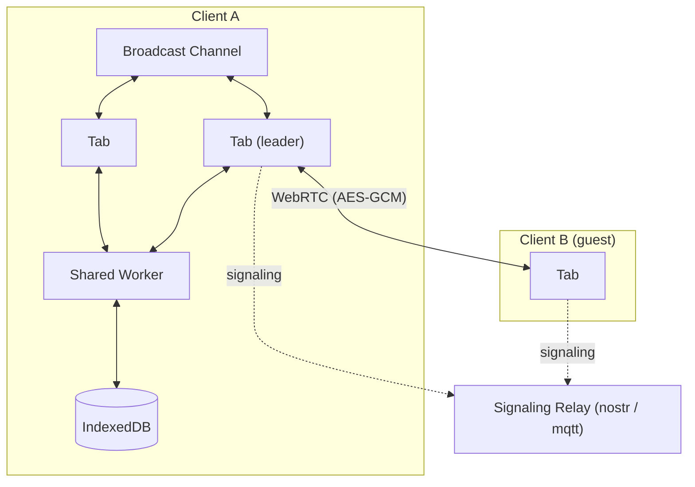

# ERD Editor

> Design database schemas visually: in your browser, in your IDE, or by asking your coding agent

English | [한국어](./README.ko.md) | [中文](./README.zh-CN.md) | [日本語](./README.ja.md)

**[Open erd-editor.io](https://erd-editor.io)** in your browser, nothing to install, or get it for
[VS Code](https://marketplace.visualstudio.com/items?itemName=dineug.vuerd-vscode),
[JetBrains IDEs](https://plugins.jetbrains.com/plugin/23594-erd-editor),
[Obsidian](https://community.obsidian.md/plugins/erd-editor) and
[Google Drive](https://workspace.google.com/marketplace/app/erd_editor/428467403360).

<picture>
  <source media="(prefers-color-scheme: dark)" srcset="https://github.com/dineug/erd-editor/blob/main/img/erd-editor-vscode-dark.png?raw=true">
  
</picture>

One editor and one `.erd.json` file wherever you work: on the web, in Google Drive, VS Code,
JetBrains IDEs and Obsidian, inside your own app, and in your coding agent's hands.

## Features

- **Design** — tables, columns, memos and table groups, four relationship cardinalities, ON DELETE
  and ON UPDATE, alternate keys, Auto Layout
- **Naming standards** — logical and physical names, physical names and data types derived from
  word, term and domain dictionaries, which have their own tab with CSV import and export and checks
- **Import** — SQL DDL, GraphQL SDL, DBML and AML, replacing the diagram or adding to it
- **Export** — DDL for eight databases, code in 22 languages and ORMs, PNG and SVG
- **Navigate** — command palette (`Ctrl`/`Cmd`+`K`), an Explorer tree with find and replace, Graph
  and Flow views
- **History** — undo and redo, time travel through the session, a diff viewer against another file
- **25 languages** and a System, Light or Dark theme with your own gray and accent colors
- **Collaboration** — live sessions on erd-editor.io, and [coding agents](#coding-agents) that edit
  beside you

**Databases:** Databricks, MariaDB, MSSQL, MySQL, Oracle, PostgreSQL, Snowflake, SQLite

**Code:** TypeScript, GraphQL, C#, Java, JPA, Kotlin, Scala, Go, SQLAlchemy, TypeORM, Sequelize,
Drizzle, DBML, AML, Mermaid, PHP, Doctrine, Rust, SeaORM, Swift, Zod, JSON Schema

Every feature step by step: the [Editing Guide](https://docs.erd-editor.io/docs/category/guides).

## Coding agents

Ask Claude Code, Codex or any MCP client to change the schema, and watch it happen on the canvas.


[`@dineug/erd-editor-mcp`](./packages/mcp-server) gives the agent one tool per editing operation.
When VS Code, Obsidian or a JetBrains IDE holds the diagram, the agent joins it as one more
collaborator, and its undo reverts only its own edits; with no editor, it edits the file on disk.
An editor with its connection off, or an untrusted workspace or project, lets the agent read but
refuses its edits. It needs Node.js 22.12 or later. Add it with one command, in your project folder:

```sh
# Claude Code
claude mcp add --transport stdio erd-editor -- npx -y @dineug/erd-editor-mcp
# Codex
codex mcp add erd-editor -- npx -y @dineug/erd-editor-mcp
```

Other clients and the tool list: [its README](./packages/mcp-server).

## Where to use it

| | Install | |
| --- | --- | --- |
| **Web app** | [erd-editor.io](https://erd-editor.io) | Installable PWA that works offline, with real-time collaboration |
| **Google Drive** | [Google Workspace Marketplace](https://workspace.google.com/marketplace/app/erd_editor/428467403360) | Drive's Open with and New menus, saving back to the same file |
| **VS Code** | [Marketplace](https://marketplace.visualstudio.com/items?itemName=dineug.vuerd-vscode) | Opens `.erd.json` files |
| **IntelliJ** | [JetBrains Marketplace](https://plugins.jetbrains.com/plugin/23594-erd-editor) | Opens `.erd.json` files in IntelliJ-based IDEs |
| **Obsidian** | [Community plugins](https://community.obsidian.md/plugins/erd-editor) | Opens `.erd` and `.erd.json` files in a vault, desktop only |
| **Your app** | `npm install @dineug/erd-editor` | The `<erd-editor>` custom element and the read-only `<erd-viewer>`, no framework needed |
| **Coding agents** | [`@dineug/erd-editor-mcp`](./packages/mcp-server) | MCP server for Claude Code, Codex and other clients |

In an IDE, create an empty `.erd.json` file and open it. In Obsidian, run
**ERD Editor: Create new diagram**; in Google Drive, choose **New → More → ERD Editor**.

## Real-time collaboration

Every ERD Editor shares its edits as a stream of actions, which keeps several views of one diagram
in sync, such as browser tabs or split editors, and lets a coding agent join as one more
collaborator.

On [erd-editor.io](https://erd-editor.io), choose **Start session** from the collaboration button in
the sidebar and share the link: everyone who opens it edits with you. The link is the only key,
so share it only with people you would let edit. The session lives in the host's browser and ends
when the host closes their last tab, so a guest who wants the diagram exports it first.

Peers connect over WebRTC, with the diagram and every edit encrypted by AES-GCM. The signaling relay
never sees plaintext, and the room key lives in the URL fragment, which browsers leave out of every
request.

<details>
<summary>Architecture</summary>



</details>

## Embedding

```sh
npm install @dineug/erd-editor
```

```js
import '@dineug/erd-editor/erd-editor.js';

const editor = document.createElement('erd-editor');
// the editor fills its container, and a custom element is inline by default
Object.assign(editor.style, { display: 'block', width: '100%', height: '100vh' });
document.body.appendChild(editor);
```

To show a diagram without editing it, import `@dineug/erd-editor/erd-viewer.js` and place
`<erd-viewer src="diagram.erd.json" style="display: block; height: 480px"></erd-viewer>`, which
pans, zooms and searches it within the box its style gives it. Importing the package root defines
neither element.

A page that cannot load scripts, such as a wiki or a site builder, can frame the hosted viewer
instead:

```html
<iframe src="https://erd-editor.io/embed?src=https%3A%2F%2Fexample.com%2Fdiagram.erd.json" width="100%" height="480" style="border: 0" loading="lazy" title="ERD Editor"></iframe>
```

The builder at [erd-editor.io/embed](https://erd-editor.io/embed) writes that line from a file's URL
and the viewer's options, and the server holding the file has to allow erd-editor.io's cross-origin
requests (CORS). A file or gist on GitHub can be given by the address its page shows, such as
`https://github.com/you/repo/blob/main/schema.erd.json`, encoded into `src` as the builder encodes
any address. The hosted viewer fetches it from GitHub's raw host, which caches each file for five
minutes and works for public repositories and for gists, but not for private repositories; of a gist
it shows the first file.

Both elements work from any framework or from none. Attributes and the element API:
[`packages/erd-editor`](./packages/erd-editor).

## Documentation

- [Editing Guide](https://docs.erd-editor.io/docs/category/guides) — every editor feature
- [Element API](https://docs.erd-editor.io/docs/api/erd-editor-element) — `<erd-editor>` for your
  own app; `<erd-viewer>` is in [`packages/erd-editor`](./packages/erd-editor)
- [MCP](https://docs.erd-editor.io/docs/mcp/introduction) — the MCP server and its tools
- [Documentation](https://docs.erd-editor.io)

## Packages

A pnpm workspace. [`@dineug/erd-editor`](./packages/erd-editor) and
[`@dineug/erd-editor-mcp`](./packages/mcp-server) are published to npm, the three plugins ship
through their stores, `app` is erd-editor.io, and the rest are private libraries those builds take
in.

<details>
<summary>All 20 packages</summary>

| Folder | npm name | Description |
| --- | --- | --- |
| [`erd-editor`](./packages/erd-editor) | `@dineug/erd-editor` | The editor core: the `<erd-editor>` custom element, the read-only `<erd-viewer>` and the headless `engine.js` and `peer.js` entries |
| [`erd-editor-schema`](./packages/erd-editor-schema) | `@dineug/erd-editor-schema` | The v2/v3 document schema, parsing, serializers, queries and LWW operators |
| [`schema-sql-parser`](./packages/schema-sql-parser) | `@dineug/schema-sql-parser` | Permissive DDL parser used for SQL import |
| [`uuid`](./packages/uuid) | `@dineug/uuid` | UUIDv7 and the Uuid25 encoding, the ids the editor mints |
| [`r-html`](./packages/r-html) | `@dineug/r-html` | The tagged-template rendering framework and store the editor is built on |
| [`vite-plugin-r-html`](./packages/vite-plugin-r-html) | `@dineug/vite-plugin-r-html` | JSX → tagged templates, plus HMR boundaries |
| [`r-html-konva`](./packages/r-html-konva) | `@dineug/r-html-konva` | The Konva host for r-html templates, which the editor's canvas renders through |
| [`grid`](./packages/grid) | `@dineug/grid` | A spreadsheet grid on a Konva canvas, built on `r-html-konva`, that draws only the cells in view |
| [`app`](./packages/app) | `@dineug/erd-editor-app` | The React PWA at erd-editor.io, with the Google Drive editor at `/gdrive`, whose OAuth relay is the Pages Function in `functions/` |
| [`vscode-extension`](./packages/vscode-extension) | `vuerd-vscode` | The published VS Code extension, with its side of the coding-agent hub |
| [`vscode-webview`](./packages/vscode-webview) | `@dineug/erd-editor-vscode-webview` | The bundle inside the VS Code webview |
| [`webview-client`](./packages/webview-client) | `@dineug/erd-editor-webview-client` | The editor mounted into an IDE webview, host protocol wired, shared by both IDE bundles |
| [`webview-bridge`](./packages/webview-bridge) | `@dineug/erd-editor-webview-bridge` | Typed host ↔ webview command protocol |
| [`replication-store-worker`](./packages/replication-store-worker) | `@dineug/erd-editor-replication-store-worker` | Headless document replica in a Worker, serializing what the IDE webviews and the Obsidian plugin save |
| [`intellij-webview`](./packages/intellij-webview) | `@dineug/erd-editor-intellij-webview` | The bundle inside the IntelliJ plugin's editor panel |
| [`intellij-plugin`](./packages/intellij-plugin) | `@dineug/erd-editor-intellij-plugin` | The published IntelliJ plugin, in Kotlin and Gradle, with its own Kotlin hub for coding agents |
| [`obsidian-plugin`](./packages/obsidian-plugin) | `@dineug/erd-editor-obsidian-plugin` | The Obsidian plugin, released from [erd-editor-obsidian-plugin](https://github.com/dineug/erd-editor-obsidian-plugin) |
| [`agent-hub`](./packages/agent-hub) | `@dineug/erd-editor-agent-hub` | The protocol between an editor window and a coding agent's MCP server: messages, lock files, framing |
| [`agent-hub-host`](./packages/agent-hub-host) | `@dineug/erd-editor-agent-hub-host` | The editor window's side of that protocol, shared by the VS Code extension and the Obsidian plugin; the IntelliJ plugin ports it to Kotlin |
| [`mcp-server`](./packages/mcp-server) | `@dineug/erd-editor-mcp` | The published MCP server, live in VS Code, Obsidian or a JetBrains IDE, or headless on the file |

</details>

## Development

You need Node 22.22.1+, 24.11+ or 26+ (`.nvmrc` pins `22.23.2`), pnpm `10.34.3` and Git 2.32+; the
IntelliJ plugin also needs JDK 17+.

```sh
pnpm install
pnpm --filter @dineug/erd-editor exec playwright install --with-deps chromium # for pnpm test
pnpm --filter @dineug/erd-editor-app dev # the web app
pnpm check # format and lint
pnpm test  # every package's type check and specs
pnpm build
```

The IntelliJ plugin builds with Gradle from [`packages/intellij-plugin`](./packages/intellij-plugin),
and the e2e suites run apart from `pnpm test`. [AGENTS.md](./AGENTS.md) has the rest: which checks a
change runs, coverage, the e2e suites and the commit rules.

## Contributing

[Issues](https://github.com/dineug/erd-editor/issues) and pull requests are welcome. Commit
messages follow [Conventional Commits](https://www.conventionalcommits.org/).

## License

[MIT](./LICENSE) © SeungHwan-Lee
