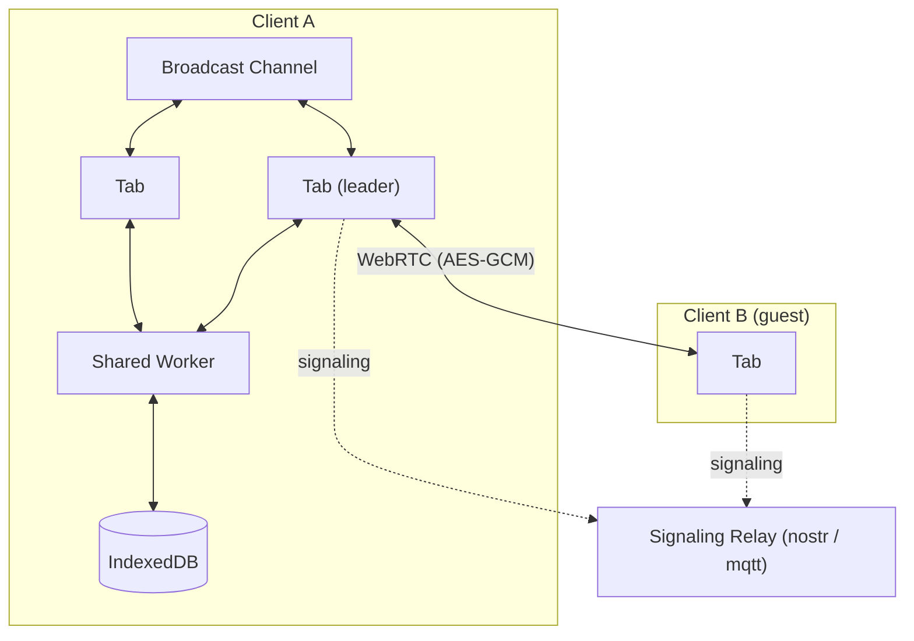

# ERD Editor

> Entity-Relationship Diagram Editor

English | [한국어](./README.ko.md) | [中文](./README.zh-CN.md) | [日本語](./README.ja.md)


Design a database schema visually, bring in one you already have from SQL DDL, GraphQL SDL, DBML or
AML, and take it out as DDL or as generated code. ERD Editor is one editor and one file format on
erd-editor.io, in Google Drive, VS Code, IntelliJ-based IDEs and Obsidian, and in your own page as a
custom element, and a coding agent edits the same diagrams through its MCP server.

## Where to use it

| | Install | |
| --- | --- | --- |
| **Web app** | [erd-editor.io](https://erd-editor.io) | Installable PWA that launches offline, real-time collaboration |
| **Google Drive** | [Google Workspace Marketplace](https://workspace.google.com/marketplace/app/erd_editor/428467403360) | Adds ERD Editor to Drive's Open with and New menus, saving back to the same file |
| **VS Code** | [Marketplace](https://marketplace.visualstudio.com/items?itemName=dineug.vuerd-vscode) | Opens `.erd.json` files in a custom editor |
| **IntelliJ** | [JetBrains Marketplace](https://plugins.jetbrains.com/plugin/23594-erd-editor) | Same, for IntelliJ-based IDEs |
| **Obsidian** | [Community plugins](https://community.obsidian.md/plugins/erd-editor) | Opens `.erd` and `.erd.json` files in a vault tab, desktop only |
| **Your app** | `npm install @dineug/erd-editor` | The framework-free `<erd-editor>` custom element |
| **Coding agents** | [`@dineug/erd-editor-mcp`](#coding-agents) | An MCP server for Claude Code, Codex or another client, live in VS Code, a JetBrains IDE or Obsidian, or on the file |

To try it in an IDE, create an empty file with a `.erd.json` extension and open it. In Obsidian,
run **ERD Editor: Create new diagram** from Obsidian's command palette. In Google Drive, choose
**New → More → ERD Editor**.

## Features

### Design

- **Visual schema design** — tables, columns, memos, and four relationship cardinalities (Zero One,
  Zero N, One Only, One N)
- **Quick edits** — `Alt`+`N` adds a table and `Alt`+`Enter` a column, `Alt`+`K` toggles the primary
  key on the focused column, or on every selected column when it is one of them, and `Delete` or
  `Backspace` removes the selection, each in one undo step; the Shortcuts page of the editor's
  Settings tab lists every key
- **Link existing columns** — while you draw a relationship with a mouse or a pen, the buttons
  beside the table it ends on either map the parent's key onto columns that table already has or add
  new ones, named after the parent table when the key is one word (`user_id` for `user`'s `id`), and
  **Map Columns** in a relationship's right-click menu changes its columns later
- **Referential actions** — set **On Delete** and **On Update** (NO ACTION, CASCADE, SET NULL, SET
  DEFAULT, RESTRICT) from a relationship's right-click menu, which marks one the current database
  leaves out; the line shows them at its child end as `D:C U:R`, and View Option's Referential
  Actions hides the labels. SQL, DBML and AML import read them, and the DDL export and the code
  generators that have a place for them write the ones the target supports
- **Alternate keys** — View Option's Alternate Key marks the columns of each unique index over two
  or more columns as `AK1.1`, `AK1.2`, and SQL import reads a UNIQUE over several columns as one
  such index
- **Table groups** — draw a box behind related tables, which you name and can color, with
  **New Table Group** in the canvas menu or the command palette, or group the selected tables from
  their right-click menu. A table joins a group when you drop it inside and leaves when you drop it
  outside, dragging a group by its title moves its tables with it, each member's header takes the
  group's color, View Option hides the groups, and DBML import and the Code Generator's DBML carry
  them as `TableGroup`s
- **Auto Layout** — place every table again by Force, Flow or a vertical or horizontal tree from the
  canvas menu or the command palette, table groups kept together, in one undo step; Force shows a
  preview you apply or cancel, and the others land at once
- **Copy, paste and colors** — copy tables and memos and paste them as new ones, into another
  diagram too or into a spreadsheet as a grid, hold `Alt` while dragging to duplicate them, and
  color a table, memo or table group from its right-click menu
- **Clean diffs** — the scroll position and zoom, the open tab, the code generator's language and
  name cases and the bracket type are locked by default, so the file keeps the values they had when
  locked and looking around never changes it; the file, written in a fixed order, also leaves out
  measured widths, connector anchors and removed items

### Import

- **SQL DDL import** — bring in a `.sql` dump from any of the eight vendors below. The parser reads
  `CREATE TABLE`, `CREATE INDEX`, `ALTER TABLE` constraints and table and column comments
  (`COMMENT ON`, SQL Server's `sp_addextendedproperty`), and skips what it does not recognize, so an
  awkward dump imports partially rather than failing outright
- **GraphQL SDL import** — bring in a schema from any tool that emits SDL. Object types become
  tables, scalars map to the diagram's own dialect, and the fields that point at another type become
  the relationships; the root types and the wrapper types Relay, Federation and Hasura generate are
  left out rather than drawn as tables
- **DBML import** — bring in a `.dbml` file written for dbdiagram.io or dbdocs.io, or emitted by
  `sql2dbml` or `prisma-dbml-generator`. Tables, columns, indexes, enums, header colors, every `Ref`
  spelling and each `TableGroup` arrive; a `Project` or a sticky `Note` is skipped rather than
  refused
- **AML import** — bring in an `.aml` file written for [Azimutt](https://azimutt.app), in either the
  v2 or the legacy v1 spelling. Entities, attributes, indexes, enums, colors and every relation
  arrow arrive; a check and a struct type are skipped rather than refused, and a view arrives as a
  table
- **Imports land laid out** — a schema picked from the Import menu, the command palette or a host's
  file dialog arrives with its tables placed by their relationships (in rows when it has none), and
  one undo puts the previous diagram back. A SQL, DBML, AML or GraphQL file imported into
  erd-editor.io's schema list or the Google Drive editor becomes a new diagram laid out the same way
- **Import and Add** — the menu beside Import, and its five formats in the command palette, add a
  `.sql`, GraphQL, DBML, AML or `.erd.json` file to the diagram instead of replacing it: its tables
  arrive below everything already there, laid out the same way (an `.erd.json` file keeps its own
  placement), selected, and one undo takes them away. A table whose name is already taken arrives as
  a second table rather than merging, and a foreign key to a table outside the file is dropped

### Export and code

- **SQL DDL export** — Databricks, MariaDB, MSSQL, MySQL, Oracle, PostgreSQL, Snowflake and SQLite,
  from the Schema SQL tab, which saves the DDL as a `.sql` file or copies it
- **Schema SQL options** — a panel beside the DDL picks the database and the bracket type, CREATE
  TABLE IF NOT EXISTS or drop and re-create and a `USE` or `CREATE + USE` header, each where the
  database has it, and the tables by table group, and keeps SQL of your own to write before and
  after the tables. The statements, header and tables stay with this editor until you close it and
  never reach the file; the scripts are saved in the document
- **Code generation** — TypeScript, GraphQL, C#, Java, JPA, Kotlin, Scala, Go, SQLAlchemy, TypeORM,
  Sequelize, Drizzle, DBML, AML, Mermaid, PHP, Doctrine, Rust, SeaORM, Swift, Zod and JSON Schema,
  from the Code Generator tab. Its options panel picks the language, the database, the table and
  column name cases and, for Doctrine, JPA and SeaORM, the bracket type, and saves the code as a
  file with the language's extension
- **Export** — `.erd.json`, `.sql`, and a `.png` or `.svg` from a dialog with a preview: transparent
  background, light or dark, the PNG at 1x to 3x or copied to the clipboard instead

### Find and navigate

- **Quick search** — `Ctrl`/`Cmd`+`K` opens the command palette to run editor commands (new table,
  import, export, Auto Layout, tabs, theme, language and more), or to jump to a table after `#`, a
  column after `@`, and a comment or memo after `:`; Korean also matches by its initial consonants
  (`ㅅㅇㅈ` finds 사용자)
- **Find and replace** — `Ctrl`/`Cmd`+`F` searches table and column names, comments and memos, with
  match case, whole word and regular expressions, and one undo takes back a Replace All
- **Visualization** — Graph mode draws a force-directed view of how the tables relate. Flow mode
  lays them out by their relationships, lights a table you hover and the tables it relates to, and
  shows names only, keys only or all fields; **Focus on this table** in a table's right-click menu
  opens Flow on that table and its neighbours, or, when it is one of several selected tables, as
  **Focus on selected tables** on all of them and their neighbours, as `Alt`+`F` does for the
  selection, and neither view writes its layout into the file
- **Zoom and pan** — pinch a trackpad or two fingers to zoom, drag with the middle button to pan
  from anywhere, and click the zoom level on the floating toolbar to go back to 100%
- **Time travel** — replay this editing session's history on the canvas and jump to any point in it,
  from the toolbar
- **Diff viewer** — compare the diagram with another `.json` file from the canvas menu
- **Undo / redo** — every edit, from the toolbar or `Ctrl`/`Cmd`+`Z` and `Ctrl`/`Cmd`+`Shift`+`Z`,
  in the editor's own history

### Language and theme

- **Display language** — the editor's menus, panels, dialogs, command palette and messages in 25
  languages, Arabic, Hebrew and Persian laid out right to left while the diagram stays left to
  right. Pick one from the toolbar's language button or **Display Language** in the command palette,
  or System, the default, which follows the language of the browser or the host and shows English
  for one the editor does not offer; table and column names, SQL keywords, data types and generated
  code stay as they are
- **Theme** — the toolbar's theme builder picks the appearance (System, Light or Dark), a gray color
  and an accent color, and **Theme** in the command palette picks the appearance; System follows the
  operating system's or the host's light or dark theme, and the pick is kept in the browser on
  erd-editor.io and in each plugin's settings, while the npm element leaves it to its host
- **Welcome screen** — an empty diagram you can edit opens on a menu of New Table, New Memo, Import,
  Command Palette and Shortcuts, with arrows at the toolbar's search, theme and language buttons and
  at the floating toolbar where the canvas has room, until its first table, shown memo or shown
  table group; the npm element shows it, its language picker and its theme builder only once its host
  turns them on, and shows English until its host sets a language or turns the picker on

### Collaboration and coding agents

- **Real-time collaboration** (experimental) — start a session from erd-editor.io's sidebar and
  share its link: everyone who opens it edits the diagram with you, peer to peer and end-to-end
  encrypted, with no backend holding your schema. Embedders get the same action stream through the
  element's `getSharedStore()`
- **Coding agents** — Claude Code, Codex or any other MCP client edits a diagram through
  [`@dineug/erd-editor-mcp`](./packages/mcp-server), live on the canvas in VS Code, Obsidian or a
  JetBrains IDE, where the agent's undo reverts only its own edits, or on the file itself when no
  editor holds it

## Embedding

```sh
npm install @dineug/erd-editor
```

```js
import '@dineug/erd-editor';

const editor = document.createElement('erd-editor');
// the editor fills its container, and a custom element is inline by default
Object.assign(editor.style, { display: 'block', width: '100%', height: '100vh' });
document.body.appendChild(editor);
```

It is a custom element, so it works from any framework or from none. See
[`packages/erd-editor`](./packages/erd-editor) for installation, attributes and the element API.

## Real-time collaboration (experimental)

Open a schema on [erd-editor.io](https://erd-editor.io), choose **Start session** from its
collaboration button in the sidebar, and share the link. Everyone who opens it edits the diagram
with you, and their edits are saved in your browser: the link is the only key, so share it only with
people you would let edit. Each participant can set a nickname, shown in the participant list and
beside their pointer.

The session lives in the host's browser: guests keep no copy of the diagram, and it ends when the
host closes their last tab, so a guest who wants the diagram exports it first.

Sessions are peer-to-peer over WebRTC, and the diagram and every edit are encrypted with AES-GCM. A
signaling relay introduces the peers and never sees plaintext; the room's secret key lives in the
URL fragment, which browsers leave out of every request, so neither the relay nor erd-editor.io's
server receives it. In the host's browser, the open tabs elect a leader that holds the peer
connections for all of them; each guest tab joins on its own.

<details>
<summary>Architecture</summary>



</details>

## Coding agents

[`@dineug/erd-editor-mcp`](./packages/mcp-server) is an MCP server that gives Claude Code, Codex or
any other MCP client one tool per editing operation: add a table, rename a column, relate two
tables, import a DDL dump, read the schema back as SQL. When a VS Code window, an Obsidian vault or
a JetBrains IDE has the diagram open, or holds it in its workspace, vault or project, the agent
joins that editor as one more collaborator: each change shows up on the canvas as it happens, and
the agent's undo reverts only its own edits. With no editor holding the diagram, the same tools
edit the file on disk. An editor with its connection turned off, or a VS Code workspace or
JetBrains project you have not trusted, lets the agent read but refuses its edits, which the
editor's next save would overwrite. The server needs Node.js 22.12 or later; for Claude Code, run
this in your project folder:

```sh
claude mcp add --transport stdio erd-editor -- npx -y @dineug/erd-editor-mcp
```

Its [README](./packages/mcp-server) sets up Codex and other clients and lists the current tools;
the [MCP docs](https://docs.erd-editor.io/docs/mcp/introduction) cover installing the server and
live and headless editing.


## Documentation

- [Editing Guide](https://docs.erd-editor.io/docs/category/guides) — editing, import and export,
  relationships, quick search, visualization, code generation, settings
- [Element API](https://docs.erd-editor.io/docs/api/erd-editor-element) — the `<erd-editor>`
  element's API
- [MCP](https://docs.erd-editor.io/docs/mcp/introduction) — installing the MCP server, live and
  headless editing, the tools
- [Documentation](https://docs.erd-editor.io)

## Packages

This is a pnpm workspace. Two packages are published to npm:
[`@dineug/erd-editor`](./packages/erd-editor), the editor itself, syntax highlighting included, and
[`@dineug/erd-editor-mcp`](./packages/mcp-server), the MCP server for coding agents. The three
plugins ship through their own stores, `app` is erd-editor.io, and the rest are private libraries
and bundles those builds take in.

<details>
<summary>All 18 packages</summary>

| Folder | npm name | Description |
| --- | --- | --- |
| [`erd-editor`](./packages/erd-editor) | `@dineug/erd-editor` | The editor core: the `<erd-editor>` custom element and the headless `engine.js` and `peer.js` entries |
| [`erd-editor-schema`](./packages/erd-editor-schema) | `@dineug/erd-editor-schema` | The v2/v3 document schema, parsing, serializers, queries and LWW operators |
| [`schema-sql-parser`](./packages/schema-sql-parser) | `@dineug/schema-sql-parser` | Permissive DDL parser used for SQL import |
| [`uuid`](./packages/uuid) | `@dineug/uuid` | UUIDv7 and the Uuid25 encoding, the ids the editor mints |
| [`r-html`](./packages/r-html) | `@dineug/r-html` | The tagged-template rendering framework and store the editor is built on |
| [`vite-plugin-r-html`](./packages/vite-plugin-r-html) | `@dineug/vite-plugin-r-html` | JSX → tagged templates, plus HMR boundaries |
| [`app`](./packages/app) | `@dineug/erd-editor-app` | The React PWA at erd-editor.io, with the Google Drive editor at `/gdrive`, whose OAuth relay is the Pages Function in `functions/` |
| [`vscode-extension`](./packages/vscode-extension) | `vuerd-vscode` | The published VS Code extension, with its side of the coding-agent hub |
| [`vscode-webview`](./packages/vscode-webview) | `@dineug/erd-editor-vscode-webview` | The bundle inside the VS Code webview |
| [`webview-client`](./packages/webview-client) | `@dineug/erd-editor-webview-client` | The editor mounted into an IDE webview, host protocol wired, shared by both IDE bundles |
| [`webview-bridge`](./packages/webview-bridge) | `@dineug/erd-editor-webview-bridge` | Typed host ↔ webview command protocol |
| [`replication-store-worker`](./packages/replication-store-worker) | `@dineug/erd-editor-replication-store-worker` | Headless document replica in a Worker, serializing what the IDE webviews and the Obsidian plugin save |
| [`intellij-webview`](./packages/intellij-webview) | `@dineug/erd-editor-intellij-webview` | The bundle inside the IntelliJ plugin's editor panel |
| [`intellij-plugin`](./packages/intellij-plugin) | `@dineug/erd-editor-intellij-plugin` | The published IntelliJ plugin, in Kotlin and Gradle, with its own Kotlin hub for coding agents |
| [`obsidian-plugin`](./packages/obsidian-plugin) | `@dineug/erd-editor-obsidian-plugin` | The Obsidian plugin, released from [erd-editor-obsidian-plugin](https://github.com/dineug/erd-editor-obsidian-plugin) |
| [`agent-hub`](./packages/agent-hub) | `@dineug/erd-editor-agent-hub` | The protocol between an editor window and a coding agent's MCP server: messages, lock files, framing |
| [`agent-hub-host`](./packages/agent-hub-host) | `@dineug/erd-editor-agent-hub-host` | The editor window's side of that protocol, shared by the VS Code extension and the Obsidian plugin; the IntelliJ plugin ports it to Kotlin |
| [`mcp-server`](./packages/mcp-server) | `@dineug/erd-editor-mcp` | The published MCP server, live in VS Code, Obsidian or a JetBrains IDE, or headless on the file |

</details>

## Development

You need Node 22.22.1 or later on the 22 line, 24.11 or later on the 24, or 26 and up (`.nvmrc`
pins `22.23.2`, which CI runs), Git 2.32 or later for the pre-commit hook, and pnpm `10.34.3`,
which `packageManager` pins. The IntelliJ plugin also needs a JDK 17 or later to run Gradle, whose
toolchain resolver fetches the JDK 21 the plugin compiles against if you lack it.

`pnpm test` runs `erd-editor`'s browser specs in Chromium, so install it once:

```sh
pnpm install
pnpm --filter @dineug/erd-editor exec playwright install --with-deps chromium
```

```sh
pnpm check                      # format and lint check, root tsc, tools' specs, task-input check
pnpm test                       # per package: build deps, tsc --noEmit, unit and browser specs
pnpm -r --no-bail test:coverage # each package's specs with coverage; CI runs it after pnpm test
pnpm build                      # build every package
pnpm size                       # after pnpm build: the bundle-size check CI runs
pnpm peer-graph                 # after pnpm build: the peer.js graph check CI runs
pnpm cache:clear                # empty the Vite Task cache
pnpm format                     # write formatting fixes
```

The `build` and `test` tasks go through [Vite+](https://viteplus.dev/), whose `vp` binary
`pnpm install` puts in `node_modules/.bin`; everything else is a package.json script. Filter a
package by its npm name or by `./packages/<folder>`.

```sh
pnpm exec vp run --filter @dineug/erd-editor --fail-if-no-match test   # a task
pnpm --filter @dineug/erd-editor-app dev                                # a script: the web app
```

`intellij-plugin` is the exception: a Gradle project, built and tested from its own directory,
whose package.json holds only its smoke and probe scripts. `pnpm test` never reaches its Kotlin.

```sh
cd packages/intellij-plugin
./gradlew buildWebview   # the webview bundle it packages
./gradlew runIde         # a sandbox IDE with the plugin loaded
./gradlew check          # its JUnit specs, the conformance runs and the Kover coverage gate
./gradlew buildPlugin    # the distributable zip
```

The Playwright end-to-end suites and the VS Code Extension Host suite are not part of `pnpm test`;
CI runs them as separate jobs.

```sh
pnpm --filter @dineug/erd-editor e2e   # also @dineug/r-html and @dineug/erd-editor-app
pnpm --filter vuerd-vscode e2e         # launches a real VS Code; prefix with `xvfb-run -a` on Linux
```

Everything else a change needs, which checks it runs, what it carries and the commit rules, is in
[AGENTS.md](./AGENTS.md).

## Contributing

[Issues](https://github.com/dineug/erd-editor/issues) and pull requests are welcome. Commit
messages follow [Conventional Commits](https://www.conventionalcommits.org/) and are checked
by commitlint.

## License

[MIT](./LICENSE) © SeungHwan-Lee
