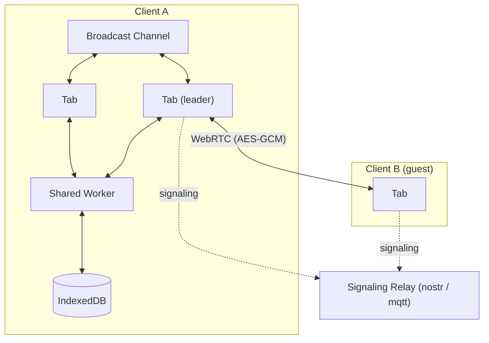

# ERD Editor

> 实体关系图编辑器

[English](./README.md) | [한국어](./README.ko.md) | 中文 | [日本語](./README.ja.md)


以可视化方式设计数据库架构，从 SQL DDL、GraphQL SDL、DBML 或 AML 导入已有的架构，再导出为 DDL 或生成的代码。ERD Editor 在 erd-editor.io、Google Drive、VS Code、IntelliJ 系列 IDE、Obsidian 以及嵌入你自己页面的自定义元素中都是同一个编辑器、同一种文件格式，编码代理则通过它的 MCP 服务器编辑同样的图。

## 在哪里使用

| | 安装 | |
| --- | --- | --- |
| **Web 应用** | [erd-editor.io](https://erd-editor.io) | 可安装的 PWA，离线也能启动，支持实时协作 |
| **Google Drive** | [Google Workspace Marketplace](https://workspace.google.com/marketplace/app/erd_editor/428467403360) | 把 ERD Editor 加入云端硬盘的"打开方式"和"新建"菜单，并保存回同一个文件 |
| **VS Code** | [Marketplace](https://marketplace.visualstudio.com/items?itemName=dineug.vuerd-vscode) | 用自定义编辑器打开 `.erd.json` 文件 |
| **IntelliJ** | [JetBrains Marketplace](https://plugins.jetbrains.com/plugin/23594-erd-editor) | 在 IntelliJ 系列 IDE 中同样如此 |
| **Obsidian** | [社区插件](https://community.obsidian.md/plugins/erd-editor) | 在仓库标签页中打开 `.erd` 和 `.erd.json` 文件，仅限桌面端 |
| **你的应用** | `npm install @dineug/erd-editor` | 不依赖框架的 `<erd-editor>` 自定义元素 |
| **编码代理** | [`@dineug/erd-editor-mcp`](#编码代理) | 面向 Claude Code、Codex 或其他客户端的 MCP 服务器，在 VS Code、JetBrains IDE 或 Obsidian 中实时编辑，否则直接编辑文件 |

在 IDE 中试用时，创建一个扩展名为 `.erd.json` 的空文件并打开它。在 Obsidian 中，从 Obsidian 的命令面板运行 **ERD Editor: Create new diagram**。在 Google Drive 中，选择 **新建 → 更多 → ERD Editor**。

## 功能

### 设计

- **可视化架构设计** — 表、列、便笺，以及四种关系基数（Zero One、Zero N、One Only、One N）
- **快捷编辑** — `Alt`+`N` 新建表，`Alt`+`Enter` 新建列，`Alt`+`K` 切换焦点所在列的主键（若该列在选区内，则作用于所有选中的列），`Delete` 或 `Backspace` 删除选中项，每项操作都可一步撤销；编辑器设置标签页的快捷键页面列出了全部按键
- **连接已有列** — 用鼠标或笔绘制关系时，终点表旁的按钮可以把父表的键映射到该表已有的列上，或新增列；新列在键名为单个单词时以父表名命名（`user` 的 `id` 对应 `user_id`），之后可通过关系右键菜单中的 **映射列** 修改
- **引用操作** — 在关系的右键菜单中设置 **删除时** 和 **更新时**（NO ACTION、CASCADE、SET NULL、SET DEFAULT、RESTRICT），当前数据库不支持的选项会被标出；连线在子表一端显示为 `D:C U:R`，视图选项中的引用操作可隐藏标签。SQL、DBML 和 AML 导入会读取它们，DDL 导出以及能表达它们的代码生成器会写出目标支持的值
- **备用键** — 打开视图选项中的备用键后，跨两列或更多列的每个唯一索引的列会标为 `AK1.1`、`AK1.2`，SQL 导入会把跨多列的 UNIQUE 读作这样的一个索引
- **表分组** — 通过画布菜单或命令面板中的 **新建表分组**，在相关的表后面画一个可命名、可着色的框，或从选中表的右键菜单将它们分组。把表拖入框内即加入分组，拖出即退出；拖动分组标题会连同其中的表一起移动，每个成员的表头会采用分组颜色，视图选项可隐藏分组，DBML 导入和代码生成器的 DBML 会以 `TableGroup` 承载它们
- **自动布局** — 从画布菜单或命令面板，用力导向、流程或纵向/横向树重新放置所有表，表分组保持在一起，一步即可撤销；力导向会显示可应用或取消的预览，其余方式立即生效
- **复制、粘贴和颜色** — 复制表和便笺并作为新项粘贴，也可以粘贴到另一张图中，或作为表格粘贴到电子表格；按住 `Alt` 拖动可复制，表、便笺或表分组的颜色在右键菜单中设置
- **干净的差异** — 滚动位置和缩放、打开的标签页、代码生成器的语言和命名风格以及引号类型默认是锁定的，因此文件保留锁定时的值，四处查看不会改动文件；文件按固定顺序写入，也不包含测量得到的宽度、连线锚点和已删除的项

### 导入

- **SQL DDL 导入** — 导入下面八种数据库中任意一种的 `.sql` 转储。解析器读取 `CREATE TABLE`、`CREATE INDEX`、`ALTER TABLE` 约束以及表和列的注释（`COMMENT ON`、SQL Server 的 `sp_addextendedproperty`），无法识别的内容会跳过，所以不规整的转储也能部分导入而不是整体失败
- **GraphQL SDL 导入** — 导入任何能输出 SDL 的工具生成的架构。对象类型变为表，标量映射到图自己的类型方言，指向其他类型的字段变为关系；根类型以及 Relay、Federation、Hasura 生成的包装类型会被排除，不画成表
- **DBML 导入** — 导入为 dbdiagram.io 或 dbdocs.io 编写、或由 `sql2dbml`、`prisma-dbml-generator` 输出的 `.dbml` 文件。表、列、索引、枚举、表头颜色、各种写法的 `Ref` 和每个 `TableGroup` 都会导入；`Project` 或便签式 `Note` 会被跳过而不是拒绝
- **AML 导入** — 导入为 [Azimutt](https://azimutt.app) 编写的 `.aml` 文件，v2 和旧版 v1 写法均可。实体、属性、索引、枚举、颜色和各种关系箭头都会导入；check 和 struct 类型会被跳过而不是拒绝，view 会作为表导入
- **导入即布局** — 从导入菜单、命令面板或宿主的文件对话框选择的架构，其表会按关系摆放好（没有关系时按行排列）后进入图中，一步撤销即可恢复之前的图。导入到 erd-editor.io 架构列表或 Google Drive 编辑器的 SQL、DBML、AML 或 GraphQL 文件会成为一张以同样方式布局的新图
- **导入并添加** — 导入旁边的菜单及命令面板中的五种格式，会把 `.sql`、GraphQL、DBML、AML 或 `.erd.json` 文件添加到图中而不是替换它：其表以同样方式布局在已有内容下方（`.erd.json` 文件保留自身的位置），处于选中状态，一步撤销即可移除。名称已存在的表会作为第二张表加入而不是合并，指向文件之外的表的外键会被丢弃

### 导出与代码

- **SQL DDL 导出** — Databricks、MariaDB、MSSQL、MySQL、Oracle、PostgreSQL、Snowflake 和 SQLite，在架构 SQL 标签页中把 DDL 保存为 `.sql` 文件或复制
- **架构 SQL 选项** — DDL 旁的面板可选择数据库和引号类型、CREATE TABLE IF NOT EXISTS 或先删除再重建、`USE` 或 `CREATE + USE` 头部（仅在数据库支持时），按表分组选择表，并保存你在表之前和之后自行编写的 SQL。语句、头部和表的选择只在这个编辑器关闭前保留，不会写入文件；脚本则保存在文档中
- **代码生成** — 在代码生成器标签页生成 TypeScript、GraphQL、C#、Java、JPA、Kotlin、Scala、Go、SQLAlchemy、TypeORM、Sequelize、Drizzle、DBML、AML、Mermaid、PHP、Doctrine、Rust、SeaORM、Swift、Zod 和 JSON Schema。选项面板可选择语言、数据库、表名和列名的命名风格，Doctrine、JPA 和 SeaORM 还可选引号类型，并把代码保存为带有该语言扩展名的文件
- **导出** — `.erd.json`、`.sql`，以及通过带预览的对话框导出 `.png` 或 `.svg`：透明背景、浅色或深色，PNG 可选 1x 到 3x，或改为复制到剪贴板

### 查找与导航

- **快速搜索** — `Ctrl`/`Cmd`+`K` 打开命令面板，运行编辑器命令（新建表、导入、导出、自动布局、标签页、主题、语言等），或在 `#` 后输入跳转到表、`@` 后跳转到列、`:` 后跳转到注释或便笺；韩文还支持按初声匹配（`ㅅㅇㅈ` 可找到 사용자）
- **查找和替换** — `Ctrl`/`Cmd`+`F` 在表名、列名、注释和便笺中查找，支持区分大小写、全字匹配和正则表达式，全部替换可一步撤销
- **可视化** — 图谱模式以力导向视图展示表之间的关系。流程模式按关系摆放表，高亮悬停的表及与之相关的表，并可只显示名称、只显示键或显示全部字段；表右键菜单中的 **聚焦此表** 以该表及其相邻表打开流程视图，选中多张表时则为 **聚焦所选表**，显示所有选中的表及其相邻表，`Alt`+`F` 对选区的作用相同。两种视图都不会把布局写入文件
- **缩放与平移** — 触控板双指捏合缩放，按住中键拖动可从任意位置平移，点击浮动工具栏上的缩放比例回到 100%
- **时间旅行** — 从工具栏在画布上回放本次编辑会话的历史，并跳到其中任意时刻
- **差异查看器** — 从画布菜单将图与另一个 `.json` 文件进行比较
- **撤销 / 重做** — 每一次编辑都可通过工具栏或 `Ctrl`/`Cmd`+`Z` 和 `Ctrl`/`Cmd`+`Shift`+`Z`，在编辑器自己的历史中撤销和重做

### 语言与主题

- **显示语言** — 编辑器的菜单、面板、对话框、命令面板和消息支持 25 种语言，阿拉伯语、希伯来语和波斯语从右到左排版，而图保持从左到右。从工具栏的语言按钮或命令面板中的 **显示语言** 选择，或保留默认的跟随系统，它会跟随浏览器或宿主的语言，编辑器未提供的语言则显示英文；表名、列名、SQL 关键字、数据类型和生成的代码保持不变
- **主题** — 工具栏的主题构建器可选择外观（跟随系统、浅色或深色）、灰色系和强调色，命令面板中的 **主题** 可选择外观；跟随系统会跟随操作系统或宿主的浅色/深色主题，所选值在 erd-editor.io 上保存在浏览器中，在各插件中保存在插件设置里，npm 元素则交给宿主处理
- **欢迎屏幕** — 可编辑的空图会显示一个菜单：新建表、新建便笺、导入、命令面板和快捷键，在画布有空间时还会用箭头指向工具栏的搜索、主题和语言按钮以及浮动工具栏，直到出现第一张表、便笺或显示中的表分组为止；npm 元素只有在宿主开启后才显示欢迎屏幕、语言选择器和主题构建器，并在宿主设置语言或开启选择器之前显示英文

### 协作与编码代理

- **实时协作**（实验性） — 在 erd-editor.io 的侧边栏开始一个会话并分享链接：打开链接的每个人都能和你一起编辑这张图，点对点、端到端加密，没有保存你架构的后端。嵌入方可通过元素的 `getSharedStore()` 获得同样的操作流
- **编码代理** — Claude Code、Codex 或任何其他 MCP 客户端都能通过 [`@dineug/erd-editor-mcp`](./packages/mcp-server) 编辑图：在 VS Code、Obsidian 或 JetBrains IDE 中实时呈现在画布上，代理的撤销只回退它自己的编辑；没有编辑器打开这张图时，则直接编辑文件本身

## 嵌入

```sh
npm install @dineug/erd-editor
```

```js
import '@dineug/erd-editor';

const editor = document.createElement('erd-editor');
// 编辑器会填满容器，而自定义元素默认是行内元素
Object.assign(editor.style, { display: 'block', width: '100%', height: '100vh' });
document.body.appendChild(editor);
```

它是自定义元素，所以在任何框架中或不用框架都能工作。安装、属性和元素 API 见 [`packages/erd-editor`](./packages/erd-editor)。

## 实时协作（实验性）

在 [erd-editor.io](https://erd-editor.io) 打开一个架构，从侧边栏的协作按钮选择 **Start session**，然后分享链接。打开链接的每个人都能和你一起编辑这张图，他们的编辑保存在你的浏览器中：链接是唯一的钥匙，所以只分享给你愿意让其编辑的人。每位参与者都可以设置昵称，显示在参与者列表和各自的指针旁。

会话存在于主持人的浏览器中：访客不保留图的副本，主持人关闭最后一个标签页时会话即结束，所以需要这张图的访客应先导出。

会话通过 WebRTC 点对点连接，图和每一次编辑都用 AES-GCM 加密。信令中继只负责介绍对等方，从不接触明文；房间的密钥位于 URL 片段中，浏览器不会把片段放进任何请求，所以中继和 erd-editor.io 的服务器都不会收到它。在主持人的浏览器中，打开的标签页会选出一个领导者，由它持有所有对等连接；每个访客标签页各自加入。

<details>
<summary>架构</summary>



</details>

## 编码代理

[`@dineug/erd-editor-mcp`](./packages/mcp-server) 是一个 MCP 服务器，为 Claude Code、Codex 或任何其他 MCP 客户端提供每种编辑操作一个工具：添加表、重命名列、关联两张表、导入 DDL 转储、把架构读回为 SQL。当某个 VS Code 窗口、Obsidian 仓库或 JetBrains IDE 打开了这张图，或在其工作区、仓库、项目中包含它时，代理会作为又一位协作者加入该编辑器：每个改动发生时都会出现在画布上，代理的撤销只回退它自己的编辑。没有编辑器持有这张图时，同样的工具会编辑磁盘上的文件。关闭了连接的编辑器，或你尚未信任的 VS Code 工作区、JetBrains 项目，允许代理读取但拒绝其编辑，因为编辑器的下一次保存会覆盖这些改动。服务器需要 Node.js 22.12 或更高版本；使用 Claude Code 时，在项目文件夹中运行：

```sh
claude mcp add --transport stdio erd-editor -- npx -y @dineug/erd-editor-mcp
```

它的 [README](./packages/mcp-server) 说明了 Codex 和其他客户端的设置并列出当前的工具；[MCP 文档](https://docs.erd-editor.io/docs/mcp/introduction) 介绍了服务器的安装以及实时编辑和无头编辑。


## 文档

- [编辑指南](https://docs.erd-editor.io/docs/category/guides) — 编辑、导入与导出、关系、快速搜索、可视化、代码生成、设置
- [元素 API](https://docs.erd-editor.io/docs/api/erd-editor-element) — `<erd-editor>` 元素的 API
- [MCP](https://docs.erd-editor.io/docs/mcp/introduction) — MCP 服务器的安装、实时编辑与无头编辑、工具
- [文档](https://docs.erd-editor.io)

## 包

这是一个 pnpm 工作区。发布到 npm 的包有两个：编辑器本身（含语法高亮）[`@dineug/erd-editor`](./packages/erd-editor)，以及面向编码代理的 MCP 服务器 [`@dineug/erd-editor-mcp`](./packages/mcp-server)。三个插件通过各自的商店分发，`app` 是 erd-editor.io，其余是这些构建所引用的私有库和捆绑包。

<details>
<summary>全部 18 个包</summary>

| 文件夹 | npm 名称 | 说明 |
| --- | --- | --- |
| [`erd-editor`](./packages/erd-editor) | `@dineug/erd-editor` | 编辑器核心：`<erd-editor>` 自定义元素以及无头的 `engine.js` 和 `peer.js` 入口 |
| [`erd-editor-schema`](./packages/erd-editor-schema) | `@dineug/erd-editor-schema` | v2/v3 文档架构、解析、序列化器、查询和 LWW 运算符 |
| [`schema-sql-parser`](./packages/schema-sql-parser) | `@dineug/schema-sql-parser` | SQL 导入所用的宽松 DDL 解析器 |
| [`uuid`](./packages/uuid) | `@dineug/uuid` | UUIDv7 和 Uuid25 编码，编辑器生成的 id |
| [`r-html`](./packages/r-html) | `@dineug/r-html` | 编辑器所基于的标签模板渲染框架和 store |
| [`vite-plugin-r-html`](./packages/vite-plugin-r-html) | `@dineug/vite-plugin-r-html` | JSX → 标签模板，外加 HMR 边界 |
| [`app`](./packages/app) | `@dineug/erd-editor-app` | erd-editor.io 的 React PWA，含 `/gdrive` 的 Google Drive 编辑器，其 OAuth 中继是 `functions/` 中的 Pages Function |
| [`vscode-extension`](./packages/vscode-extension) | `vuerd-vscode` | 已发布的 VS Code 扩展，含编码代理中枢在扩展这一侧的实现 |
| [`vscode-webview`](./packages/vscode-webview) | `@dineug/erd-editor-vscode-webview` | VS Code webview 内的捆绑包 |
| [`webview-client`](./packages/webview-client) | `@dineug/erd-editor-webview-client` | 挂载到 IDE webview 中的编辑器，已接好宿主协议，两个 IDE 捆绑包共用 |
| [`webview-bridge`](./packages/webview-bridge) | `@dineug/erd-editor-webview-bridge` | 类型化的宿主 ↔ webview 命令协议 |
| [`replication-store-worker`](./packages/replication-store-worker) | `@dineug/erd-editor-replication-store-worker` | 运行在 Worker 中的无头文档副本，序列化 IDE webview 和 Obsidian 插件要保存的内容 |
| [`intellij-webview`](./packages/intellij-webview) | `@dineug/erd-editor-intellij-webview` | IntelliJ 插件编辑器面板内的捆绑包 |
| [`intellij-plugin`](./packages/intellij-plugin) | `@dineug/erd-editor-intellij-plugin` | 已发布的 IntelliJ 插件，用 Kotlin 和 Gradle 编写，自带面向编码代理的 Kotlin 中枢 |
| [`obsidian-plugin`](./packages/obsidian-plugin) | `@dineug/erd-editor-obsidian-plugin` | Obsidian 插件，从 [erd-editor-obsidian-plugin](https://github.com/dineug/erd-editor-obsidian-plugin) 发布 |
| [`agent-hub`](./packages/agent-hub) | `@dineug/erd-editor-agent-hub` | 编辑器窗口与编码代理的 MCP 服务器之间的协议：消息、锁文件、帧格式 |
| [`agent-hub-host`](./packages/agent-hub-host) | `@dineug/erd-editor-agent-hub-host` | 该协议在编辑器窗口这一侧的实现，VS Code 扩展和 Obsidian 插件共用；IntelliJ 插件将其移植为 Kotlin |
| [`mcp-server`](./packages/mcp-server) | `@dineug/erd-editor-mcp` | 已发布的 MCP 服务器，在 VS Code、Obsidian 或 JetBrains IDE 中实时工作，否则以无头方式作用于文件 |

</details>

## 开发

需要 Node 22 系列 22.22.1 或更高、24 系列 24.11 或更高，或 26 及以上（`.nvmrc` 固定为 CI 使用的 `22.23.2`），pre-commit 钩子需要 Git 2.32 或更高，以及 `packageManager` 固定的 pnpm `10.34.3`。IntelliJ 插件还需要 JDK 17 或更高来运行 Gradle；插件编译所用的 JDK 21 如果没有，Gradle 的工具链解析器会自动获取。

`pnpm test` 会在 Chromium 中运行 `erd-editor` 的浏览器测试，所以先安装一次：

```sh
pnpm install
pnpm --filter @dineug/erd-editor exec playwright install --with-deps chromium
```

```sh
pnpm check                      # 格式和 lint 检查、根目录 tsc、tools 的测试、任务输入检查
pnpm test                       # 逐包执行：构建依赖、tsc --noEmit、单元测试和浏览器测试
pnpm -r --no-bail test:coverage # 各包带覆盖率的测试；CI 在 pnpm test 之后运行
pnpm build                      # 构建所有包
pnpm size                       # pnpm build 之后：CI 运行的包体积检查
pnpm peer-graph                 # pnpm build 之后：CI 运行的 peer.js 依赖图检查
pnpm cache:clear                # 清空 Vite Task 缓存
pnpm format                     # 写入格式修正
```

`build` 和 `test` 任务通过 [Vite+](https://viteplus.dev/) 运行，它的 `vp` 可执行文件由 `pnpm install` 放在 `node_modules/.bin` 中；其余都是 package.json 脚本。按 npm 名称或 `./packages/<文件夹>` 筛选包。

```sh
pnpm exec vp run --filter @dineug/erd-editor --fail-if-no-match test   # 任务
pnpm --filter @dineug/erd-editor-app dev                                # 脚本：Web 应用
```

`intellij-plugin` 是例外：它是 Gradle 项目，在自己的目录中构建和测试，package.json 里只有 smoke 和 probe 脚本。`pnpm test` 不会触及它的 Kotlin 代码。

```sh
cd packages/intellij-plugin
./gradlew buildWebview   # 插件打包的 webview 捆绑包
./gradlew runIde         # 加载了插件的沙盒 IDE
./gradlew check          # JUnit 测试、一致性检查以及 Kover 覆盖率门槛
./gradlew buildPlugin    # 可分发的 zip
```

Playwright 端到端测试套件和 VS Code Extension Host 套件不属于 `pnpm test`，CI 以单独的作业运行它们。

```sh
pnpm --filter @dineug/erd-editor e2e   # @dineug/r-html 和 @dineug/erd-editor-app 同理
pnpm --filter vuerd-vscode e2e         # 启动真实的 VS Code；Linux 上在前面加 `xvfb-run -a`
```

一次改动还需要的其他内容——要运行哪些检查、要附带什么、提交规则是什么——都在 [AGENTS.md](./AGENTS.md) 中。

## 贡献

欢迎提交 [Issue](https://github.com/dineug/erd-editor/issues) 和 Pull Request。提交信息遵循 [Conventional Commits](https://www.conventionalcommits.org/)，由 commitlint 检查。

## 许可证

[MIT](./LICENSE) © SeungHwan-Lee
