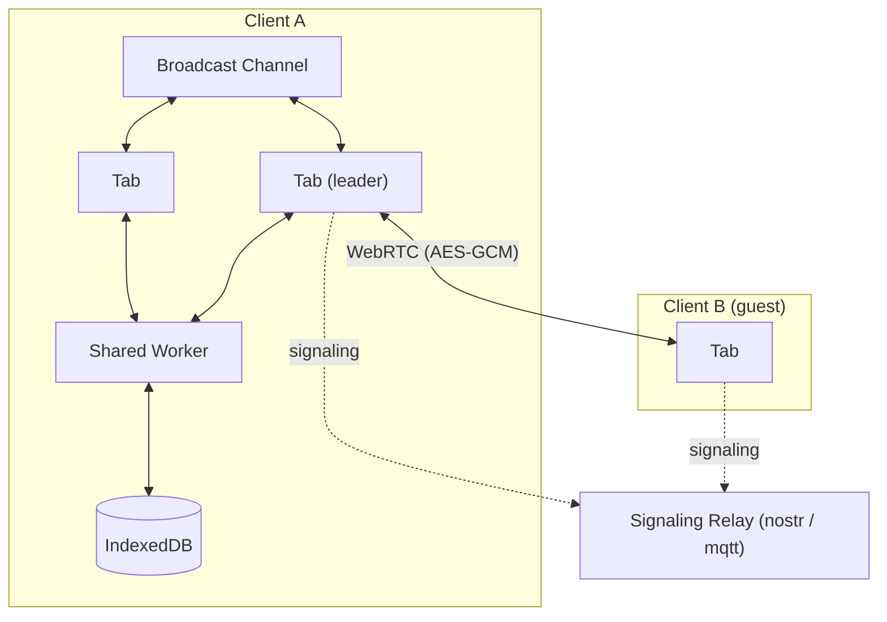

# ERD Editor

> 以可视化方式设计数据库架构：在浏览器中、在 IDE 中，或交给你的编码代理

[English](./README.md) | [한국어](./README.ko.md) | 中文 | [日本語](./README.ja.md)

**[打开 erd-editor.io](https://erd-editor.io)** — 在浏览器中直接使用，无需安装；也可以安装到 [VS Code](https://marketplace.visualstudio.com/items?itemName=dineug.vuerd-vscode)、[JetBrains IDE](https://plugins.jetbrains.com/plugin/23594-erd-editor)、[Obsidian](https://community.obsidian.md/plugins/erd-editor) 和 [Google Drive](https://workspace.google.com/marketplace/app/erd_editor/428467403360)。

<picture>
  <source media="(prefers-color-scheme: dark)" srcset="https://github.com/dineug/erd-editor/blob/main/img/erd-editor-vscode-dark.png?raw=true">
  
</picture>

无论在哪里工作，都是同一个编辑器、同一个 `.erd.json` 文件：Web、Google Drive、VS Code、JetBrains IDE、Obsidian、你自己的应用里，还有编码代理的手中。

## 功能

- **设计** — 表、列、备注、表分组，四种关系基数，ON DELETE 与 ON UPDATE，备用键，自动布局
- **命名规范** — 逻辑名与物理名，由词根、术语、域词典得出的物理名和数据类型，以及支持 CSV 导入导出和检查的独立词典标签页
- **导入** — SQL DDL、GraphQL SDL、DBML、AML，可替换整张图，也可追加到现有的图中
- **导出** — 8 种数据库的 DDL，22 种语言和 ORM 的代码，PNG 与 SVG
- **导航** — 命令面板（`Ctrl`/`Cmd`+`K`）、带查找与替换的对象资源管理器树、Graph 视图和 Flow 视图
- **历史** — 撤销与重做，回放编辑会话的时间旅行，与另一个文件比较的差异查看器
- **25 种语言**，以及可自选灰色和强调色的 System、Light、Dark 主题
- **协作** — erd-editor.io 上的实时会话，以及在旁一起编辑的[编码代理](#编码代理)

**数据库：** Databricks, MariaDB, MSSQL, MySQL, Oracle, PostgreSQL, Snowflake, SQLite

**代码：** TypeScript, GraphQL, C#, Java, JPA, Kotlin, Scala, Go, SQLAlchemy, TypeORM, Sequelize, Drizzle, DBML, AML, Mermaid, PHP, Doctrine, Rust, SeaORM, Swift, Zod, JSON Schema

每项功能的用法见[编辑指南](https://docs.erd-editor.io/docs/category/guides)。

## 编码代理

让 Claude Code、Codex 或其他 MCP 客户端修改架构，然后在画布上看着它发生。


[`@dineug/erd-editor-mcp`](./packages/mcp-server) 为代理提供每种编辑操作一个工具。当 VS Code、Obsidian 或 JetBrains IDE 持有这张图时，代理会作为又一位协作者加入，它的撤销只回退自己的编辑；没有编辑器时它直接编辑磁盘上的文件；关闭了连接的编辑器，或尚未信任的工作区、项目，允许代理读取但拒绝其编辑。需要 Node.js 22.12 或更高版本。在项目文件夹中用一条命令添加：

```sh
# Claude Code
claude mcp add --transport stdio erd-editor -- npx -y @dineug/erd-editor-mcp
# Codex
codex mcp add erd-editor -- npx -y @dineug/erd-editor-mcp
```

其他客户端的设置以及工具列表见它的 [README](./packages/mcp-server)。

## 在哪里使用

| | 安装 | |
| --- | --- | --- |
| **Web 应用** | [erd-editor.io](https://erd-editor.io) | 可离线使用的可安装 PWA，支持实时协作 |
| **Google Drive** | [Google Workspace Marketplace](https://workspace.google.com/marketplace/app/erd_editor/428467403360) | 云端硬盘的"打开方式"和"新建"菜单，保存回同一个文件 |
| **VS Code** | [Marketplace](https://marketplace.visualstudio.com/items?itemName=dineug.vuerd-vscode) | 打开 `.erd.json` 文件 |
| **IntelliJ** | [JetBrains Marketplace](https://plugins.jetbrains.com/plugin/23594-erd-editor) | 在 IntelliJ 系列 IDE 中打开 `.erd.json` 文件 |
| **Obsidian** | [社区插件](https://community.obsidian.md/plugins/erd-editor) | 打开仓库中的 `.erd` 和 `.erd.json` 文件，仅限桌面端 |
| **你的应用** | `npm install @dineug/erd-editor` | 无需框架的 `<erd-editor>` 自定义元素和只读的 `<erd-viewer>` |
| **编码代理** | [`@dineug/erd-editor-mcp`](./packages/mcp-server) | 面向 Claude Code、Codex 等 MCP 客户端的服务器 |

在 IDE 中，创建一个扩展名为 `.erd.json` 的空文件并打开它。在 Obsidian 中运行 **ERD Editor: Create new diagram**；在 Google Drive 中选择 **新建 → 更多 → ERD Editor**。

## 实时协作

ERD Editor 以动作流的形式传递每一次编辑，因此在浏览器标签页或拆分的编辑器等多处打开同一张图时都会保持同步，编码代理也能作为又一位协作者加入。

在 [erd-editor.io](https://erd-editor.io) 上，在侧边栏的协作按钮中选择 **开始会话** 并分享链接，打开链接的每个人都能和你一起编辑。链接是唯一的钥匙，所以只分享给你愿意让其编辑的人。会话存在于主持人的浏览器中，主持人关闭最后一个标签页时即结束，所以需要这张图的访客应先导出。

对等方通过 WebRTC 连接，图和每一次编辑都用 AES-GCM 加密。信令中继从不接触明文，房间密钥位于 URL 片段中，而浏览器不会把片段放进任何请求。

<details>
<summary>架构</summary>



</details>

## 嵌入

```sh
npm install @dineug/erd-editor
```

```js
import '@dineug/erd-editor/erd-editor.js';

const editor = document.createElement('erd-editor');
// 编辑器会填满容器，而自定义元素默认是行内元素
Object.assign(editor.style, { display: 'block', width: '100%', height: '100vh' });
document.body.appendChild(editor);
```

若只想展示图而不编辑，导入 `@dineug/erd-editor/erd-viewer.js` 并放置 `<erd-viewer src="diagram.erd.json" style="display: block; height: 480px"></erd-viewer>`，即可在样式给定的区域内平移、缩放和搜索这张图。只导入包的根入口不会定义任何元素。

无法加载脚本的页面（例如 wiki 或建站工具）可以改用 iframe 嵌入托管的查看器：

```html
<iframe src="https://erd-editor.io/embed?src=https%3A%2F%2Fgithub.com%2Fdineug%2Ferd-editor%2Fblob%2Fmain%2Fdata%2Fembed-small.erd.json" width="100%" height="480" style="border: 0" loading="lazy" title="ERD Editor"></iframe>
```

这一行展示的是本仓库的 [`data/embed-small.erd.json`](./data/embed-small.erd.json)。[erd-editor.io/embed](https://erd-editor.io/embed) 上的生成器会根据文件的 URL 和查看器的选项写出这一行。GitHub 上的文件或 gist 可以像这里一样直接使用其页面显示的地址。托管的查看器从 GitHub 的 raw 主机获取它，该主机会将每个文件缓存五分钟，仅适用于公开仓库和公开 gist；对于 gist，它显示第一个文件。存放在其他服务器上的文件，该服务器必须允许来自 erd-editor.io 的跨源请求（CORS）。

这两个元素在任何框架中或不用框架都能工作。属性和元素 API 见 [`packages/erd-editor`](./packages/erd-editor)。

## 文档

- [编辑指南](https://docs.erd-editor.io/docs/category/guides) — 编辑器的全部功能
- [元素 API](https://docs.erd-editor.io/docs/api/erd-editor-element) — 嵌入你自己应用的 `<erd-editor>`；`<erd-viewer>` 见 [`packages/erd-editor`](./packages/erd-editor)
- [MCP](https://docs.erd-editor.io/docs/mcp/introduction) — MCP 服务器及其工具
- [文档](https://docs.erd-editor.io)

## 包

这是一个 pnpm 工作区。[`@dineug/erd-editor`](./packages/erd-editor)、[`@dineug/erd-editor-mcp`](./packages/mcp-server) 和 [`@dineug/erd-editor-yjs`](./packages/erd-editor-yjs) 发布在 npm 上，三个插件通过各自的商店分发，`app` 即 erd-editor.io，其余是这些构建所引入的私有库。

<details>
<summary>全部 21 个包</summary>

| 文件夹 | npm 名称 | 说明 |
| --- | --- | --- |
| [`erd-editor`](./packages/erd-editor) | `@dineug/erd-editor` | 编辑器核心：`<erd-editor>` 自定义元素、只读的 `<erd-viewer>` 以及无头的 `engine.js` 和 `peer.js` 入口 |
| [`erd-editor-yjs`](./packages/erd-editor-yjs) | `@dineug/erd-editor-yjs` | 已发布的 Yjs 绑定，通过 `Y.Doc` 让 `<erd-editor>` 或无头 peer store 保持同步 |
| [`erd-editor-schema`](./packages/erd-editor-schema) | `@dineug/erd-editor-schema` | v2/v3 文档架构、解析、序列化器、查询和 LWW 运算符 |
| [`schema-sql-parser`](./packages/schema-sql-parser) | `@dineug/schema-sql-parser` | SQL 导入所用的宽松 DDL 解析器 |
| [`uuid`](./packages/uuid) | `@dineug/uuid` | UUIDv7 和 Uuid25 编码，编辑器生成的 id |
| [`r-html`](./packages/r-html) | `@dineug/r-html` | 编辑器所基于的标签模板渲染框架和 store |
| [`vite-plugin-r-html`](./packages/vite-plugin-r-html) | `@dineug/vite-plugin-r-html` | JSX → 标签模板，外加 HMR 边界 |
| [`r-html-konva`](./packages/r-html-konva) | `@dineug/r-html-konva` | r-html 模板的 Konva 宿主，编辑器的画布经由它渲染 |
| [`grid`](./packages/grid) | `@dineug/grid` | 基于 `r-html-konva` 的 Konva 画布电子表格网格，只绘制可见的单元格 |
| [`app`](./packages/app) | `@dineug/erd-editor-app` | erd-editor.io 的 React PWA，含 `/gdrive` 的 Google Drive 编辑器，其 OAuth 中继是 `functions/` 中的 Pages Function |
| [`vscode-extension`](./packages/vscode-extension) | `vuerd-vscode` | 已发布的 VS Code 扩展，含编码代理中枢在扩展这一侧的实现 |
| [`vscode-webview`](./packages/vscode-webview) | `@dineug/erd-editor-vscode-webview` | VS Code webview 内的捆绑包 |
| [`webview-client`](./packages/webview-client) | `@dineug/erd-editor-webview-client` | 挂载到 IDE webview 中的编辑器，已接好宿主协议，两个 IDE 捆绑包共用 |
| [`webview-bridge`](./packages/webview-bridge) | `@dineug/erd-editor-webview-bridge` | 类型化的宿主 ↔ webview 命令协议 |
| [`replication-store-worker`](./packages/replication-store-worker) | `@dineug/erd-editor-replication-store-worker` | 运行在 Worker 中的无头文档副本，序列化 IDE webview 和 Obsidian 插件要保存的内容 |
| [`intellij-webview`](./packages/intellij-webview) | `@dineug/erd-editor-intellij-webview` | IntelliJ 插件编辑器面板内的捆绑包 |
| [`intellij-plugin`](./packages/intellij-plugin) | `@dineug/erd-editor-intellij-plugin` | 已发布的 IntelliJ 插件，用 Kotlin 和 Gradle 编写，自带面向编码代理的 Kotlin 中枢 |
| [`obsidian-plugin`](./packages/obsidian-plugin) | `@dineug/erd-editor-obsidian-plugin` | Obsidian 插件，从 [erd-editor-obsidian-plugin](https://github.com/dineug/erd-editor-obsidian-plugin) 发布 |
| [`agent-hub`](./packages/agent-hub) | `@dineug/erd-editor-agent-hub` | 编辑器窗口与编码代理的 MCP 服务器之间的协议：消息、锁文件、帧格式 |
| [`agent-hub-host`](./packages/agent-hub-host) | `@dineug/erd-editor-agent-hub-host` | 该协议在编辑器窗口这一侧的实现，VS Code 扩展和 Obsidian 插件共用；IntelliJ 插件将其移植为 Kotlin |
| [`mcp-server`](./packages/mcp-server) | `@dineug/erd-editor-mcp` | 已发布的 MCP 服务器，在 VS Code、Obsidian 或 JetBrains IDE 中实时工作，否则以无头方式作用于文件 |

</details>

## 开发

需要 Node 22.22.1+、24.11+ 或 26+（`.nvmrc` 固定为 `22.23.2`）、pnpm `10.34.3` 和 Git 2.32+；IntelliJ 插件还需要 JDK 17+。

```sh
pnpm install
pnpm --filter @dineug/erd-editor exec playwright install --with-deps chromium # 供 pnpm test 使用
pnpm --filter @dineug/erd-editor-app dev # Web 应用
pnpm check # 格式和 lint
pnpm test  # 所有包的类型检查和测试
pnpm build
```

IntelliJ 插件在 [`packages/intellij-plugin`](./packages/intellij-plugin) 中用 Gradle 构建，e2e 测试套件独立于 `pnpm test` 运行。每次改动要运行的检查、覆盖率、e2e 套件和提交规则见 [AGENTS.md](./AGENTS.md)。

## 贡献

欢迎提交 [Issue](https://github.com/dineug/erd-editor/issues) 和 Pull Request。提交信息遵循 [Conventional Commits](https://www.conventionalcommits.org/)。

## 许可证

[MIT](./LICENSE) © SeungHwan-Lee
